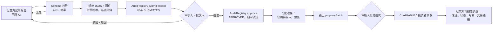

# RoboShare — 系统架构

状态：**草案（DRAFT，第 1 阶段）。** 描述目标设计。此处所述内容均尚未实现。

## 1. 原则

1. **链上记录合约能够强制执行的事实；其他一切均为声明/证明（attestation）。** 车辆购置、保险、牌照和收入均为链下事实。链上存储的是：谁、在何时、以哪个文档哈希声明了什么。
2. **三个数据层级，在服务器端强制执行：** 公开、投资者受限、私密合规。访问权限从不由 UI 决定。
3. **按项目隔离。** 每个项目拥有各自的代币、募集和分配合约。
4. **双人规则**适用于任何转移资金或变更已记录事实的操作。
5. **合约不可升级，应用可升级。** 合约修复以新部署的形式发布，用于新项目。
6. **数据库是链上真实数据的缓存，同时也是链下工作流的记录系统。** 每一行源自链上的数据都带有 `(chainId, blockNumber, blockHash, txHash, logIndex)`，且可对账。

## 2. 上下文图

```mermaid
flowchart TB
  subgraph Users[用户]
    PUB[公众访客]
    INV[投资者 + 钱包]
    OPS[运营方员工]
    REV[审核人]
    GOVS[治理签名人]
  end
  subgraph RoboShare
    WEB[apps/web<br/>Next.js]
    API[apps/api<br/>NestJS]
    WRK[apps/worker<br/>NestJS standalone]
    PG[(PostgreSQL 16)]
    RDS[(Redis 7)]
    S3[(对象存储<br/>S3 兼容，SSE + KMS)]
  end
  subgraph External[外部]
    BSC[BNB Smart Chain RPC<br/>主用 + 备用]
    KYC[KYC/AML 服务商<br/>待定]
    SAFE[Safe{Wallet}]
    AAVE[BSC 上的 Aave V3]
    EXP[BscScan 浏览器]
  end
  PUB --> WEB
  INV --> WEB
  OPS --> WEB
  REV --> WEB
  GOVS --> SAFE --> BSC
  WEB --> API
  WEB -- 钱包交易 --> BSC
  API --> PG & RDS & S3
  WRK --> PG & RDS & BSC
  WRK --> AAVE
  KYC -- 签名 webhook --> API
  API -- 入队 --> RDS
  WRK -- 合规中继器交易 --> BSC
  WEB -. 交易链接 .-> EXP
```

## 3. 组件

### 3.1 智能合约（`contracts/`）
参见 [SMART_CONTRACT_SPEC.md](SMART_CONTRACT_SPEC.md)。单例：`AssetRegistry`、`AuditRegistry`、`IdentityRegistry`、`ProjectFactory`。每个项目：`RwaShareToken`、`OfferingManager`、`RevenueDistributor`。第 5 阶段：`AaveReader`（只读）。

### 3.2 Web 应用（`apps/web`）
- Next.js App Router、React、TypeScript、Tailwind CSS、**基于 Radix 原语的 shadcn/ui**（无障碍、无样式的基础层，组件以复制方式引入，因此没有沉重的运行时依赖）。
- 使用 wagmi + viem 连接钱包（注入式钱包、WalletConnect）。链白名单来自配置：开发/测试环境为 97，仅生产构建使用 56。
- 路由分组：`(public)`、`(investor)`（需要 SIWE 会话）、`(admin)`（SIWE + 服务器端角色校验）。
- 服务器组件从 API 获取数据；客户端组件处理钱包操作。每个写操作按钮要么通过 wagmi 调用合约（先执行 `simulateContract`，以便用户看到诸如"钱包不具备投资资格"之类的回滚原因），要么调用经过身份验证的 API 端点。
- 购买流程（D-23）：首次购买时检测用户对 `SubscriptionRouter` 的 USDT 授权额度，未授权时引导用户进行无限授权（授权前展示风险提示）；之后用户只需选择项目和份额，一笔交易完成认购。界面显示授权状态，并提供撤销授权按钮。
- 需要治理的管理操作会生成一个 **Safe 交易提案**（通过 Safe Transaction Service API），而不是从浏览器密钥直接发送。
- 图表：Recharts 或 visx，并以明确的 `ACTUAL` / `PROJECTED` 样式和标签区分。

### 3.3 API（`apps/api`）
- NestJS 模块：`auth`、`projects`、`documents`、`offerings`、`portfolio`、`reports`、`distributions`、`compliance`、`admin`、`audit`、`aave`、`health`。
- **身份验证：** 以太坊登录（Sign-In with Ethereum，EIP-4361）→ 存放于 httpOnly cookie 中的短期 JWT，nonce 存储在 Redis 中。管理路由还额外要求：钱包持有对应的链上角色（依据已索引的 `RoleGranted/RoleRevoked` 进行核验）**并且**拥有启用 TOTP 的链下员工账户。
- **授权：** 按可见性层级设置 Nest 守卫：`PublicGuard`、`InvestorGuard`（会话 + 已关联到用户的钱包）、`RoleGuard(role)`。各层级的响应 DTO 相互独立，因此受限字段不会通过序列化泄露。
- **校验：** zod schema 由 `packages/shared` 共享（同一个 schema 在 API、worker 和管理 UI 中校验财务报告）。
- 私密文档在访问检查通过后通过短期预签名 URL 提供，每次下载都会写入一条访问日志记录。

### 3.4 Worker（`apps/worker`）
基于 Redis 的 BullMQ 队列：

| 队列 | 任务 |
|---|---|
| `indexer` | 跟踪链头，获取已知合约地址的日志，写入 `chain_block`、`chain_tx`、`chain_event`，再投射到领域表 |
| `reorg` | 检测父哈希不匹配，回滚到共同祖先，然后重放 |
| `reports` | 对报告 JSON 进行规范化，计算哈希，存储文件，准备 AuditRegistry 提交载荷 |
| `distribution-prep` | 根据已索引的转账计算快照区块的持有人列表，镜像分配额计算逻辑（TS）用于预览，并在提议后与合约进行交叉核对 |
| `reconcile` | 定期执行：将数据库中的余额/供应量/批次总额与 `eth_call` 结果比对；不匹配时发起事件告警 |
| `compliance-relay` | 通过限速的中继器密钥，将来自 KYC webhook 的投资资格更新发送至 `IdentityRegistry` |
| `aave-read` | 从经过验证的 Aave 地址刷新白名单内的储备数据 |
| `notifications` | 邮件/应用内通知（可选） |

### 3.5 数据存储
- **PostgreSQL 16**：链下工作流的记录系统；链上状态的派生镜像。Schema：`public`（应用）、`chain`（已索引数据）、`compliance`（受限，使用独立的数据库角色，对服务商引用使用 pgcrypto 列加密）。
- **Redis 7**：BullMQ 队列、SIWE nonce、限速计数器、公开读取的短 TTL 缓存。不是事实来源；Redis 丢失只会丢失进行中的任务，而这些任务是幂等的，可重新派生。
- **对象存储**：用于法律/财务文档的私有存储桶（服务器端加密、版本控制、对已锚定文件启用对象锁定）；可选的公开存储桶或 IPFS，用于发行方选择公开的文档。

## 4. 后端选型：NestJS

| 方案 | 优点 | 缺点 |
|---|---|---|
| **NestJS（已选定）** | 在同一代码库中一流地支持长时间运行的 worker；依赖注入和守卫可清晰地映射到三个可见性层级；成熟的测试工具（`@nestjs/testing`、supertest） | 需要额外部署一个服务 |
| Next.js 路由处理器 / server actions | 单一部署单元，与 UI 共享类型 | Serverless/边缘运行时不适合持续索引和链重组（reorg）处理；将涉及资金转移的管理逻辑与 UI 部署混在一起 |

Next.js 仍然负责渲染页面，并可代理读取请求，但所有业务逻辑都位于 API 中。

## 5. 链上索引策略

1. 配置列出各合约地址及其部署区块（来自 `infra/deployments/<chainId>.json`，仅由部署脚本写入）。
2. Worker 轮询 `eth_blockNumber`；处理至 `head − CONFIRMATIONS` 为止的区块范围（可配置；在 BSC 上初始设为 15，在测试网上测量最终性表现后再重新评估）。
3. 对范围内的每个区块，存储 `(number, hash, parentHash)`。若新区块的 `parentHash` ≠ 已存储的 `number − 1` 区块哈希，则回溯至共同祖先，在一个数据库事务中删除其之上的派生数据行，然后重放。
4. 使用 `eth_getLogs` 按地址 + 主题在有界范围内（例如 ≤ 2 000 个区块）获取日志，带重试机制和备用 RPC。
5. 每条事件行在 `(chainId, txHash, logIndex)` 上唯一；处理器均为幂等的 upsert。
6. 领域投影（持仓、认购、批次、领取）与事件插入在同一个数据库事务中更新。
7. 可选的面向 UI 的"未确认"视图会显示待处理交易，并明确标注为待处理。

## 6. 对账

定时任务（也可由管理端按需触发）：
- 每个已索引持有人的 `token.totalSupply()` 和 `balanceOf(h)` 与数据库持仓比对。
- `OfferingManager` 托管余额与数据库中托管认购的总和比对。
- 每个批次：链上总额与数据库分配额总和比对；已领取标记与数据库比对。
- 分配合约稳定币余额与未领取额 + 尾差（dust）比对。
- 角色持有者与数据库 `contract_role_grant` 比对。
出现不匹配时，写入一条 `reconciliation_issue` 记录，向值班人员告警，并且（对于资金不匹配）在问题解决之前于管理 UI 中阻止新的批次提议。

## 7. 财务报告流程



UI 中显示的标签：`Operator-submitted`（运营方提交）、`Reviewer-approved`（审核人批准），以及仅当外部审计师的签名意见已锚定时才显示的 `Externally audited (by <firm>, <date>)`（经外部审计）。手工录入的数据绝不会被标记为已审计。

## 8. 隐私层级

| 层级 | 示例 | 存储位置 | 谁可读取 |
|---|---|---|---|
| 公开 | 项目 ID、状态、供应量、文档哈希、已批准的报告摘要、分配总额、风险披露 | 链上 + `public` schema + 公开存储桶 | 任何人 |
| 投资者受限 | 完整财务报告、募集备忘录、本人的认购/持仓/领取记录 | 私有存储桶 + 带所有者检查的 `public` schema 数据行 | 合格投资者（项目文档）或所有者本人（本人记录） |
| 私密合规 | KYC 服务商引用、司法管辖区证明、合格投资者认证文件、制裁筛查结果 | `compliance` schema（加密列）+ 服务商系统 | 仅限合规人员；服务于公开/投资者路由的 API 进程不具备相应数据库授权 |

链上唯一的合规数据是每个钱包的 `{status, class code, jurisdiction code, expiry, attestationRef hash}`。

## 9. 配置与密钥

- 所有配置均通过环境变量提供，并在启动时校验（zod）。`.env.example` 仅列出变量名。
- 合约地址来自 `infra/deployments/<chainId>.json`；若缺少必需地址或地址为零，应用将拒绝启动。生产配置中不得出现占位地址。
- 生产环境密钥存放在托管的密钥存储中（云 KMS/Secrets Manager 或 Doppler/1Password）。在生产环境中，合规中继器密钥存放在由 KMS/HSM 支持的签名器中，而非普通环境变量。
- 治理密钥从不接触服务器；它们由 Safe 签名人保管在硬件钱包中。

## 10. 部署拓扑（目标）

- Web：Vercel 或置于 CDN 之后的容器化 Next.js。
- API + worker：容器（例如 Fly.io、ECS 或 Kubernetes），至少两个 API 副本和一个活跃的索引器（通过 Redis 锁进行主节点选举）。
- 托管 PostgreSQL，带 PITR 备份；托管 Redis。
- 两个相互独立的 BSC RPC 服务商。
- 可观测性：OpenTelemetry 链路追踪、结构化日志、Prometheus 风格指标（索引器延迟、对账不匹配、失败任务），告警发送至值班人员。

## 11. 无需多链代码的多链就绪

- 所有表和配置均以 `(chainId, address)` 作为合约的键。
- `packages/contracts-abi` 按 chain ID 导出地址。
- 索引器为每条已配置的链运行一个实例。
- 无跨链桥，无跨链铸造（D-18）。参见 SMART_CONTRACT_SPEC §11。
