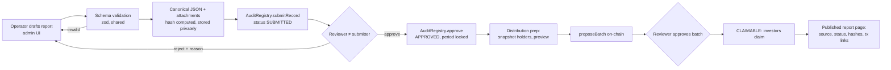

# RoboShare — System Architecture

Status: **DRAFT (Phase 1).** Describes the target design. Nothing here is implemented yet.

## 1. Principles

1. **Chain records facts the contracts can enforce; everything else is an attestation.** Vehicle purchase, insurance, licensing and revenue are off-chain facts. The chain stores who attested what, when, with which document hash.
2. **Three data tiers, enforced on the server:** public, investor-restricted, private compliance. The UI never decides access.
3. **Per-project isolation.** Each project has its own token, offering and distributor contract.
4. **Two-person rule** for anything that moves money or changes recorded facts.
5. **Non-upgradeable contracts, upgradeable apps.** Contract fixes ship as new deployments for new projects.
6. **Database is a cache of chain truth plus the system of record for off-chain workflows.** Every chain-derived row carries `(chainId, blockNumber, blockHash, txHash, logIndex)` and is reconcilable.

## 2. Context diagram

```mermaid
flowchart TB
  subgraph Users
    PUB[Public visitor]
    INV[Investor + wallet]
    OPS[Operator staff]
    REV[Reviewer]
    GOVS[Governance signers]
  end
  subgraph RoboShare
    WEB[apps/web<br/>Next.js]
    API[apps/api<br/>NestJS]
    WRK[apps/worker<br/>NestJS standalone]
    PG[(PostgreSQL 16)]
    RDS[(Redis 7)]
    S3[(Object storage<br/>S3-compatible, SSE + KMS)]
  end
  subgraph External
    BSC[BNB Smart Chain RPC<br/>primary + fallback]
    KYC[KYC/AML provider<br/>TBD]
    SAFE[Safe{Wallet}]
    AAVE[Aave V3 on BSC]
    EXP[BscScan explorer]
  end
  PUB --> WEB
  INV --> WEB
  OPS --> WEB
  REV --> WEB
  GOVS --> SAFE --> BSC
  WEB --> API
  WEB -- wallet tx --> BSC
  API --> PG & RDS & S3
  WRK --> PG & RDS & BSC
  WRK --> AAVE
  KYC -- signed webhook --> API
  API -- enqueue --> RDS
  WRK -- compliance relayer tx --> BSC
  WEB -. tx links .-> EXP
```

## 3. Components

### 3.1 Smart contracts (`contracts/`)
See [SMART_CONTRACT_SPEC.md](SMART_CONTRACT_SPEC.md). Singletons: `AssetRegistry`, `AuditRegistry`, `IdentityRegistry`, `ProjectFactory`. Per project: `RwaShareToken`, `OfferingManager`, `RevenueDistributor`. Phase 5: `AaveReader` (view-only).

### 3.2 Web app (`apps/web`)
- Next.js App Router, React, TypeScript, Tailwind CSS, **shadcn/ui on Radix primitives** (accessible, unstyled base, copy-in components so no heavy runtime dependency).
- wagmi + viem for wallets (injected, WalletConnect). Chain allowlist from config: 97 in dev/test, 56 only in production builds.
- Route groups: `(public)`, `(investor)` (SIWE session required), `(admin)` (SIWE + server-side role).
- Server components fetch from the API; client components handle wallet actions. Every write button calls either a contract via wagmi (with `simulateContract` first, so the user sees revert reasons such as "wallet not eligible") or an authenticated API endpoint.
- Admin actions that require governance produce a **Safe transaction proposal** (via Safe Transaction Service API) instead of sending from a browser key.
- Charts: Recharts or visx with explicit `ACTUAL` / `PROJECTED` styling and labels.

### 3.3 API (`apps/api`)
- NestJS modules: `auth`, `projects`, `documents`, `offerings`, `portfolio`, `reports`, `distributions`, `compliance`, `admin`, `audit`, `aave`, `health`.
- **Auth:** Sign-In with Ethereum (EIP-4361) → short-lived JWT in httpOnly cookie, nonce stored in Redis. Admin routes additionally require that the wallet holds the matching on-chain role (checked against indexed `RoleGranted/RoleRevoked`) **and** an off-chain staff account with TOTP.
- **Authorization:** Nest guards per visibility tier: `PublicGuard`, `InvestorGuard` (session + wallet linked to user), `RoleGuard(role)`. Response DTOs are separate per tier so restricted fields cannot leak through serialization.
- **Validation:** zod schemas shared from `packages/shared` (one schema validates financial reports in API, worker, and admin UI).
- Private documents served through short-lived pre-signed URLs after an access check, with an access log row per download.

### 3.4 Workers (`apps/worker`)
BullMQ queues on Redis:

| Queue | Job |
|---|---|
| `indexer` | follow chain head, fetch logs for known contract addresses, write `chain_block`, `chain_tx`, `chain_event`, then project domain tables |
| `reorg` | detect parent-hash mismatch, roll back to common ancestor, replay |
| `reports` | canonicalize report JSON, compute hash, store file, prepare AuditRegistry submission payload |
| `distribution-prep` | compute holder list at snapshot block from indexed transfers, mirror allocation math (TS) for preview, cross-check against contract after proposal |
| `reconcile` | periodic: compare DB balances/supply/batch totals with `eth_call` results; raise incident on mismatch |
| `compliance-relay` | send eligibility updates from KYC webhooks to `IdentityRegistry` via a rate-limited relayer key |
| `aave-read` | refresh allowlisted reserve data from verified Aave addresses |
| `notifications` | email/in-app notices (optional) |

### 3.5 Data stores
- **PostgreSQL 16**: system of record for off-chain workflows; derived mirror of chain state. Schemas: `public` (app), `chain` (indexed), `compliance` (restricted, separate DB role, pgcrypto column encryption for provider references).
- **Redis 7**: BullMQ queues, SIWE nonces, rate-limit counters, short-TTL cache for public reads. Not a source of truth; loss of Redis loses only in-flight jobs, which are idempotent and re-derived.
- **Object storage**: private bucket for legal/financial documents (server-side encryption, versioning, object lock for anchored files); optional public bucket or IPFS for documents the issuer chooses to publish.

## 4. Backend choice: NestJS

| Option | For | Against |
|---|---|---|
| **NestJS (chosen)** | First-class long-running workers in the same codebase; DI and guards map cleanly onto three visibility tiers; mature testing (`@nestjs/testing`, supertest) | Extra service to deploy |
| Next.js route handlers / server actions | One deployable, shared types with UI | Serverless/edge runtime is a poor fit for continuous indexing and reorg handling; mixes admin money-moving logic with UI deploys |

Next.js still renders pages and may proxy reads, but all business logic lives in the API.

## 5. Chain indexing strategy

1. Config lists contract addresses with their deployment block (from `infra/deployments/<chainId>.json`, written only by deployment scripts).
2. Worker polls `eth_blockNumber`; processes ranges up to `head − CONFIRMATIONS` (configurable; start at 15 on BSC and revisit after measuring finality behaviour on testnet).
3. For each block in range it stores `(number, hash, parentHash)`. If a new block's `parentHash` ≠ stored hash at `number − 1`, it walks back to the common ancestor, deletes derived rows above it in one DB transaction, and replays.
4. Logs fetched with `eth_getLogs` by address + topics in bounded ranges (e.g. ≤ 2 000 blocks), with retries and a fallback RPC.
5. Each event row is unique on `(chainId, txHash, logIndex)`; handlers are idempotent upserts.
6. Domain projections (holdings, subscriptions, batches, claims) update in the same DB transaction as the event insert.
7. Optional "unconfirmed" view for UI shows pending txs clearly labelled as pending.

## 6. Reconciliation

Scheduled job (and on-demand from admin):
- `token.totalSupply()` and `balanceOf(h)` for every indexed holder vs. DB holdings.
- `OfferingManager` escrow balance vs. DB sum of escrowed subscriptions.
- Per batch: on-chain totals vs. DB allocation sums; claimed flags vs. DB.
- Distributor stablecoin balance vs. unclaimed + dust.
- Role holders vs. DB `contract_role_grant`.
Mismatch writes a `reconciliation_issue` row, alerts on-call, and (for money mismatches) blocks new batch proposals in the admin UI until resolved.

## 7. Financial reporting pipeline



Labels shown in the UI: `Operator-submitted`, `Reviewer-approved`, and only if an external auditor's signed opinion is anchored, `Externally audited (by <firm>, <date>)`. Manual data is never labelled audited.

## 8. Privacy tiers

| Tier | Examples | Where stored | Who can read |
|---|---|---|---|
| Public | project ID, state, supply, document hashes, approved report summaries, distribution totals, risk disclosures | chain + `public` schema + public bucket | anyone |
| Investor-restricted | full financial reports, offering memorandum, own subscriptions/holdings/claims | private bucket + `public` schema rows with owner checks | eligible investors (project docs) or the owner (own records) |
| Private compliance | KYC provider reference, jurisdiction evidence, accreditation documents, sanctions screening results | `compliance` schema (encrypted columns) + provider systems | compliance staff only; API process for public/investor routes has no DB grant |

On-chain the only compliance data is `{status, class code, jurisdiction code, expiry, attestationRef hash}` per wallet.

## 9. Configuration and secrets

- All configuration via environment variables validated at startup (zod). `.env.example` lists names only.
- Contract addresses come from `infra/deployments/<chainId>.json`; the app refuses to start if a required address is missing or zero. No placeholder addresses in production config.
- Production secrets in a managed secret store (cloud KMS/Secrets Manager or Doppler/1Password). The compliance relayer key lives in a KMS/HSM-backed signer, not a plain env var, in production.
- Governance keys never touch servers; they live with Safe signers on hardware wallets.

## 10. Deployment topology (target)

- Web: Vercel or containerized Next.js behind a CDN.
- API + worker: containers (e.g. Fly.io, ECS, or Kubernetes) with at least two API replicas and one active indexer (leader election via Redis lock).
- Managed PostgreSQL with PITR backups; managed Redis.
- Two independent BSC RPC providers.
- Observability: OpenTelemetry traces, structured logs, Prometheus-style metrics (indexer lag, reconciliation mismatches, failed jobs), alerting to on-call.

## 11. Multi-chain readiness without multi-chain code

- All tables and configs key contracts by `(chainId, address)`.
- `packages/contracts-abi` exports addresses per chain ID.
- Indexer runs one instance per configured chain.
- No bridge, no cross-chain mint (D-18). See SMART_CONTRACT_SPEC §11.
