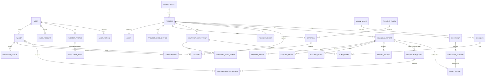

# RoboShare — Database Schema

Status: **DRAFT (Phase 1).** Logical design for PostgreSQL 16 via Prisma. Column lists are indicative; the Prisma schema in Phase 3 is authoritative once written.

## 1. Conventions

- Primary keys: `uuid` (v7) unless the natural key is a chain identifier.
- Money: `numeric(78,0)` in token base units plus `payment_token_id` (never floats, never pre-scaled decimals). Display scaling happens in the UI using the token's on-chain `decimals`.
- Addresses: `citext` checksummed on write, unique per `(chain_id, address)`.
- Chain-derived rows carry `chain_id, block_number, block_hash, tx_hash, log_index` and FK to `chain.event`.
- `created_at`, `updated_at` on every table; soft delete is **not** used for financial or audit rows (they are append-only).
- Figures carry `figure_kind` enum `ACTUAL | PROJECTED` wherever a number could be mistaken for the other.
- Schemas: `app` (application), `chain` (indexed chain data), `compliance` (restricted).

## 2. Entity relationship diagram

## 3. Tables

### 3.1 Identity and access (`app`)

| Table | Key columns | Notes |
|---|---|---|
| `user` | id, display_name (optional), email (optional, encrypted), status | No KYC data here |
| `wallet` | id, user_id, chain_id, address, linked_at, is_primary | unique (chain_id, address) |
| `siwe_session` | id, wallet_id, nonce, issued_at, expires_at, revoked_at | |
| `staff_account` | id, user_id, totp_secret_enc, roles text[], disabled_at | off-chain role mirror; on-chain role still required |
| `investor_profile` | id, user_id, investor_class_code, jurisdiction_code, risk_ack_version, risk_ack_at | codes only |
| `eligibility_status` | id, wallet_id, status (NONE/ELIGIBLE/FROZEN), class, jurisdiction, expires_at, attestation_ref_hash, source (PROVIDER/TEST_ONLY_MOCK), chain_event_id | append-only history; current = latest confirmed |

### 3.2 Compliance (`compliance`, restricted DB role)

| Table | Key columns | Notes |
|---|---|---|
| `compliance_case` | id, investor_profile_id, provider, provider_ref_enc, status, decided_at, expires_at, reviewer_id | pgcrypto-encrypted provider ref |
| `compliance_document` | id, case_id, storage_key_enc, doc_type, retention_until | files in private bucket only |
| `screening_result` | id, case_id, list_type, result, checked_at | sanctions/PEP results |
| `compliance_access_log` | id, staff_id, case_id, action, at, ip_hash | every read logged |

Retention: per jurisdictional policy (to be defined by counsel); a scheduled job purges past `retention_until`.

### 3.3 Projects and assets (`app`)

| Table | Key columns | Notes |
|---|---|---|
| `issuing_entity` | id, legal_name, entity_type, jurisdiction, registration_ref, issuer_id_onchain (bytes32), formation_doc_version_id | |
| `project` | id, project_id_onchain (bytes32, unique), slug, title, issuing_entity_id, state, rights_doc_version_id, legal_interest_type (CONTRACTUAL_ECONOMIC_RIGHT / SPV_EQUITY / DEBT), funded_at_block | `state` mirrored from chain only |
| `asset` | id, project_id (unique), asset_id_onchain (bytes32, unique), vin_enc, vin_salt_enc, make, model, model_year, status, acquired_at (ACTUAL only, nullable) | VIN encrypted; public API exposes make/model only |
| `project_state_change` | id, project_id, from_state, to_state, reason_record_id, actor_address, chain_event_id | |
| `project_figure` | id, project_id, metric, period, value, unit, figure_kind (ACTUAL/PROJECTED), source_record_id | projections never stored as ACTUAL |

### 3.4 Offerings (`app`)

| Table | Key columns | Notes |
|---|---|---|
| `payment_token` | id, chain_id, address, symbol, decimals (read on-chain), allowlisted | |
| `offering` | id, project_id (unique), contract_deployment_id, payment_token_id, unit_price, max_units, min_units, per_wallet_max, start_at, end_at, treasury_address, terms_record_id, status | config mirrored from `OfferingConfigured` |
| `subscription` | id, offering_id, wallet_id, units, amount, status (ESCROWED/SETTLED/REFUNDABLE/REFUNDED), chain_event_id (last) | one row per wallet, aggregates multiple `Subscribed` events |
| `subscription_event` | id, subscription_id, kind, units, amount, chain_event_id | raw history |

### 3.5 Holdings (`app`)

| Table | Key columns | Notes |
|---|---|---|
| `token_transfer` | id, project_id, from_address, to_address, units, kind (MINT/TRANSFER/FORCED), chain_event_id | unique per chain event |
| `holding` | project_id, wallet_address, units, last_block | PK (project_id, wallet_address); projection of transfers |
| `holding_snapshot` | project_id, block_number, wallet_address, units | materialized for batch preparation; verified against `balanceOfAt` |

### 3.6 Financial reporting (`app`)

| Table | Key columns | Notes |
|---|---|---|
| `financial_report` | id, project_id, period_start, period_end, version, supersedes_report_id, status (DRAFT/SUBMITTED/APPROVED/REJECTED/SUPERSEDED), payment_token_id, gross_revenue, total_expenses, total_reserves, distributable_amount, canonical_hash, storage_key, submitted_by, submitted_at, audit_record_id, assurance_level (OPERATOR_SUBMITTED/REVIEWER_APPROVED/EXTERNALLY_AUDITED) | unique (project_id, period_start, period_end) where status = APPROVED |
| `revenue_entry` | id, report_id, category, description, amount, evidence_document_version_id | |
| `expense_entry` | id, report_id, category, description, amount, evidence_document_version_id | |
| `reserve_entry` | id, report_id, kind (MAINTENANCE/INSURANCE/TAX/DEBT_SERVICE/OTHER), amount, rationale | |
| `report_review` | id, report_id, reviewer_user_id, decision, reason, decided_at | DB check: reviewer ≠ submitter |

DB constraint: `distributable_amount = gross_revenue − total_expenses − total_reserves` (or an explicit, documented adjustment line), checked in a trigger and in the zod schema.

### 3.7 Distributions (`app`)

| Table | Key columns | Notes |
|---|---|---|
| `distribution_batch` | id, project_id, batch_id_onchain, report_id, amount, carried_dust_in, pool, total_net, total_fee, dust_out, snapshot_block, status (DRAFT/PROPOSED/CLAIMABLE/REJECTED), proposer_address, approver_address, funder_address, propose_event_id, approve_event_id | unique (project_id, batch_id_onchain) |
| `distribution_allocation` | id, batch_id, wallet_address, units, gross, fee_bps, fee, net, claimed, claim_event_id | sums reconciled with batch totals |

### 3.8 Documents and audit (`app`)

| Table | Key columns | Notes |
|---|---|---|
| `document` | id, project_id, doc_type, title, visibility (PUBLIC/INVESTOR/PRIVATE) | |
| `document_version` | id, document_id, version, content_hash, hash_alg, storage_key, size_bytes, mime, uploaded_by, uploaded_at, audit_record_id | immutable once anchored |
| `audit_record` | id, record_id_onchain, project_id, kind, status, content_hash, period_start, period_end, supersedes_record_id, submitter, reviewer, chain_event_ids | mirror of AuditRegistry |
| `document_access_log` | id, document_version_id, user_id, at | for INVESTOR/PRIVATE downloads |

### 3.9 Contracts and chain (`chain`)

| Table | Key columns | Notes |
|---|---|---|
| `contract_deployment` | id, chain_id, address, kind, project_id (nullable), deployed_block, deploy_tx_hash, abi_version, verified_on_explorer | written by deployment import, never by hand-entered placeholders |
| `contract_role_grant` | id, contract_deployment_id, role, account, granted_event_id, revoked_event_id | |
| `block` | chain_id, number, hash, parent_hash, timestamp, status (PENDING/CONFIRMED/ORPHANED) | PK (chain_id, number, hash) |
| `tx` | chain_id, hash, block_number, from, to, status, gas_used | |
| `event` | id, chain_id, block_number, block_hash, tx_hash, log_index, address, topic0, name, args jsonb, processed_at | unique (chain_id, tx_hash, log_index) |
| `indexer_cursor` | chain_id, contract_set, last_confirmed_block, last_confirmed_hash | |
| `reconciliation_run` / `reconciliation_issue` | id, run_at, scope, expected, actual, severity, resolved_at | |
| `pending_tx` | id, user_id, chain_id, hash, purpose, status | UI-submitted txs awaiting confirmation |

### 3.10 Admin

| Table | Key columns | Notes |
|---|---|---|
| `admin_action` | id, user_id, wallet_address, action, target_type, target_id, payload_hash, safe_tx_hash, created_at | append-only; every admin API mutation writes one |

## 4. Transactions and integrity

- Indexer writes event + projection updates in one transaction; reorg rollback deletes by `block_number > ancestor` in one transaction.
- Report submission: report + lines + hash in one transaction; status changes only via the workflow service.
- Batch preparation reads `holding_snapshot` under `REPEATABLE READ`.
- DB roles: `app_api` (no access to `compliance`), `app_compliance`, `app_worker`, `app_migrator`. Row-level security on `subscription`, `holding`, `distribution_allocation` for investor-scoped queries as defence in depth.

## 5. Reorg handling

- Rows from blocks in `PENDING` status are shown as pending in the UI.
- On reorg: mark orphaned blocks `ORPHANED`, delete dependent `event` rows and projections, replay from ancestor. Projections are fully re-derivable from `chain.event`, so a full rebuild is also possible.
