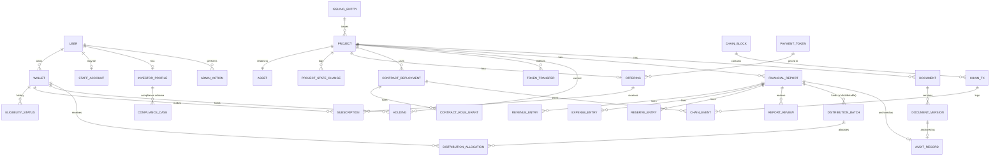

# RoboShare — 数据库模式

状态：**草案（DRAFT，第 1 阶段）。** 基于 Prisma 的 PostgreSQL 16 逻辑设计。列清单仅为示意；第 3 阶段的 Prisma schema 一经编写即为权威依据。

## 1. 约定

- 主键：`uuid`（v7），除非自然键是链上标识符。
- 金额：以代币基础单位表示的 `numeric(78,0)`，外加 `payment_token_id`（绝不使用浮点数，也绝不使用预先缩放的小数）。显示时的缩放在 UI 中依据代币链上的 `decimals` 完成。
- 地址：`citext`，写入时进行校验和（checksum）格式化，按 `(chain_id, address)` 唯一。
- 来源于链上的行携带 `chain_id, block_number, block_hash, tx_hash, log_index`，并以外键关联 `chain.event`。
- 每张表都有 `created_at`、`updated_at`；财务或审计类行**不**使用软删除（它们只追加、不修改）。
- 凡是某个数字可能被误认为另一种类型的地方，数值都携带 `figure_kind` 枚举 `ACTUAL | PROJECTED`。
- Schema：`app`（应用）、`chain`（已索引的链上数据）、`compliance`（受限）。

## 2. 实体关系图

## 3. 表

### 3.1 身份与访问（`app`）

| 表 | 关键列 | 说明 |
|---|---|---|
| `user` | id, display_name（可选）, email（可选，加密）, status | 此处不存放 KYC 数据 |
| `wallet` | id, user_id, chain_id, address, linked_at, is_primary | (chain_id, address) 唯一 |
| `siwe_session` | id, wallet_id, nonce, issued_at, expires_at, revoked_at | |
| `staff_account` | id, user_id, totp_secret_enc, roles text[], disabled_at | 链下角色镜像；仍需具备链上角色 |
| `investor_profile` | id, user_id, investor_class_code, jurisdiction_code, risk_ack_version, risk_ack_at | 仅存代码 |
| `eligibility_status` | id, wallet_id, status (NONE/ELIGIBLE/FROZEN), class, jurisdiction, expires_at, attestation_ref_hash, source (PROVIDER/TEST_ONLY_MOCK), chain_event_id | 只追加的历史记录；当前状态 = 最新一条已确认记录 |

### 3.2 合规（`compliance`，受限数据库角色）

| 表 | 关键列 | 说明 |
|---|---|---|
| `compliance_case` | id, investor_profile_id, provider, provider_ref_enc, status, decided_at, expires_at, reviewer_id | 服务商引用以 pgcrypto 加密 |
| `compliance_document` | id, case_id, storage_key_enc, doc_type, retention_until | 文件仅存放于私有存储桶 |
| `screening_result` | id, case_id, list_type, result, checked_at | 制裁/政治公众人物（PEP）筛查结果 |
| `compliance_access_log` | id, staff_id, case_id, action, at, ip_hash | 每次读取均记录日志 |

保留期限：依各司法辖区政策而定（由法律顾问确定）；定时任务会清除超过 `retention_until` 的数据。

### 3.3 项目与资产（`app`）

| 表 | 关键列 | 说明 |
|---|---|---|
| `issuing_entity` | id, legal_name, entity_type, jurisdiction, registration_ref, issuer_id_onchain (bytes32), formation_doc_version_id | |
| `project` | id, project_id_onchain (bytes32, unique), slug, title, issuing_entity_id, state, rights_doc_version_id, legal_interest_type (CONTRACTUAL_ECONOMIC_RIGHT / SPV_EQUITY / DEBT), funded_at_block | `state` 仅从链上镜像 |
| `asset` | id, project_id (unique), asset_id_onchain (bytes32, unique), vin_enc, vin_salt_enc, make, model, model_year, status, acquired_at（仅 ACTUAL，可为空） | VIN 加密存储；公开 API 仅暴露品牌/型号 |
| `project_state_change` | id, project_id, from_state, to_state, reason_record_id, actor_address, chain_event_id | |
| `project_figure` | id, project_id, metric, period, value, unit, figure_kind (ACTUAL/PROJECTED), source_record_id | 预测值绝不以 ACTUAL 存储 |

### 3.4 募集（`app`）

| 表 | 关键列 | 说明 |
|---|---|---|
| `payment_token` | id, chain_id, address, symbol, decimals（从链上读取）, allowlisted | |
| `offering` | id, project_id (unique), contract_deployment_id, payment_token_id, unit_price, max_units, min_units, per_wallet_max, start_at, end_at, treasury_address, terms_record_id, status | 配置从 `OfferingConfigured` 镜像 |
| `subscription` | id, offering_id, wallet_id, units, amount, status (ESCROWED/SETTLED/REFUNDABLE/REFUNDED), chain_event_id（最后一条） | 每个钱包一行，汇总多个 `Subscribed` 事件 |
| `subscription_event` | id, subscription_id, kind, units, amount, chain_event_id | 原始历史记录 |

### 3.5 持仓（`app`）

| 表 | 关键列 | 说明 |
|---|---|---|
| `token_transfer` | id, project_id, from_address, to_address, units, kind (MINT/TRANSFER/FORCED), chain_event_id | 每个链上事件唯一 |
| `holding` | project_id, wallet_address, units, last_block | 主键 (project_id, wallet_address)；由转账记录投影生成 |
| `holding_snapshot` | project_id, block_number, wallet_address, units | 为准备分配批次而物化；以 `balanceOfAt` 进行核验 |

### 3.6 财务报告（`app`）

| 表 | 关键列 | 说明 |
|---|---|---|
| `financial_report` | id, project_id, period_start, period_end, version, supersedes_report_id, status (DRAFT/SUBMITTED/APPROVED/REJECTED/SUPERSEDED), payment_token_id, gross_revenue, total_expenses, total_reserves, distributable_amount, canonical_hash, storage_key, submitted_by, submitted_at, audit_record_id, assurance_level (OPERATOR_SUBMITTED/REVIEWER_APPROVED/EXTERNALLY_AUDITED) | 当 status = APPROVED 时 (project_id, period_start, period_end) 唯一 |
| `revenue_entry` | id, report_id, category, description, amount, evidence_document_version_id | |
| `expense_entry` | id, report_id, category, description, amount, evidence_document_version_id | |
| `reserve_entry` | id, report_id, kind (MAINTENANCE/INSURANCE/TAX/DEBT_SERVICE/OTHER), amount, rationale | |
| `report_review` | id, report_id, reviewer_user_id, decision, reason, decided_at | 数据库检查：审核人 ≠ 提交人 |

数据库约束：`distributable_amount = gross_revenue − total_expenses − total_reserves`（或一条明确且有记录的调整行），在触发器和 zod schema 中同时校验。

### 3.7 分配（`app`）

| 表 | 关键列 | 说明 |
|---|---|---|
| `distribution_batch` | id, project_id, batch_id_onchain, report_id, amount, carried_dust_in, pool, total_net, total_fee, dust_out, snapshot_block, status (DRAFT/PROPOSED/CLAIMABLE/REJECTED), proposer_address, approver_address, funder_address, propose_event_id, approve_event_id | (project_id, batch_id_onchain) 唯一 |
| `distribution_allocation` | id, batch_id, wallet_address, units, gross, fee_bps, fee, net, claimed, claim_event_id | 合计值与批次总额进行对账 |

### 3.8 文档与审计（`app`）

| 表 | 关键列 | 说明 |
|---|---|---|
| `document` | id, project_id, doc_type, title, visibility (PUBLIC/INVESTOR/PRIVATE) | |
| `document_version` | id, document_id, version, content_hash, hash_alg, storage_key, size_bytes, mime, uploaded_by, uploaded_at, audit_record_id | 一经上链锚定即不可变更 |
| `audit_record` | id, record_id_onchain, project_id, kind, status, content_hash, period_start, period_end, supersedes_record_id, submitter, reviewer, chain_event_ids | AuditRegistry 的镜像 |
| `document_access_log` | id, document_version_id, user_id, at | 用于 INVESTOR/PRIVATE 文档下载 |

### 3.9 合约与链（`chain`）

| 表 | 关键列 | 说明 |
|---|---|---|
| `contract_deployment` | id, chain_id, address, kind, project_id（可为空）, deployed_block, deploy_tx_hash, abi_version, verified_on_explorer | 由部署导入写入，绝不使用手工录入的占位值 |
| `contract_role_grant` | id, contract_deployment_id, role, account, granted_event_id, revoked_event_id | |
| `block` | chain_id, number, hash, parent_hash, timestamp, status (PENDING/CONFIRMED/ORPHANED) | 主键 (chain_id, number, hash) |
| `tx` | chain_id, hash, block_number, from, to, status, gas_used | |
| `event` | id, chain_id, block_number, block_hash, tx_hash, log_index, address, topic0, name, args jsonb, processed_at | (chain_id, tx_hash, log_index) 唯一 |
| `indexer_cursor` | chain_id, contract_set, last_confirmed_block, last_confirmed_hash | |
| `reconciliation_run` / `reconciliation_issue` | id, run_at, scope, expected, actual, severity, resolved_at | |
| `pending_tx` | id, user_id, chain_id, hash, purpose, status | 由 UI 提交、等待确认的交易 |

### 3.10 管理

| 表 | 关键列 | 说明 |
|---|---|---|
| `admin_action` | id, user_id, wallet_address, action, target_type, target_id, payload_hash, safe_tx_hash, created_at | 只追加；每次管理 API 变更操作都会写入一条 |

## 4. 事务与完整性

- 索引器在同一事务中写入事件及投影更新；链重组（reorg）回滚在同一事务中按 `block_number > ancestor` 删除数据。
- 报告提交：报告 + 明细行 + 哈希在同一事务中写入；状态只能通过工作流服务变更。
- 准备分配批次时在 `REPEATABLE READ` 隔离级别下读取 `holding_snapshot`。
- 数据库角色：`app_api`（无权访问 `compliance`）、`app_compliance`、`app_worker`、`app_migrator`。作为纵深防御，对 `subscription`、`holding`、`distribution_allocation` 启用行级安全，用于限定投资者范围的查询。

## 5. 链重组（reorg）处理

- 来自 `PENDING` 状态区块的行在 UI 中显示为待确认。
- 发生链重组时：将孤立区块标记为 `ORPHANED`，删除相关的 `event` 行及投影，并从共同祖先区块重放。投影可完全从 `chain.event` 重新推导，因此也可以进行完整重建。
