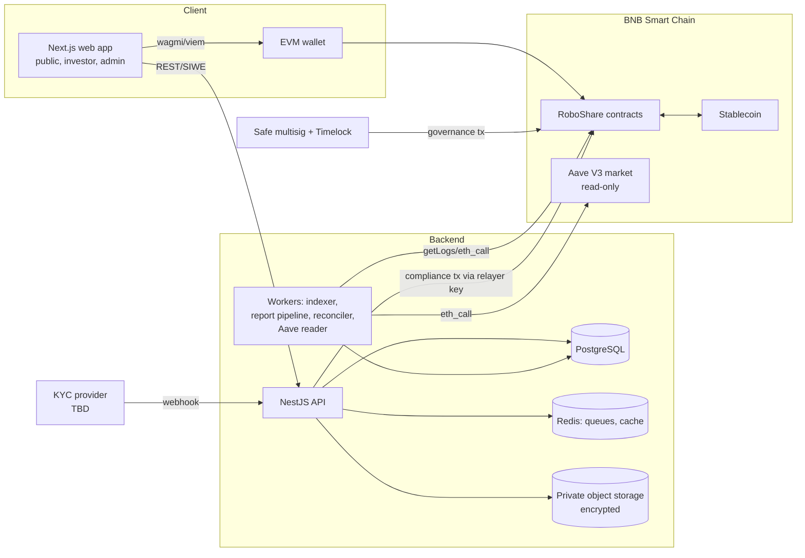
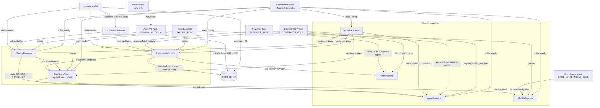
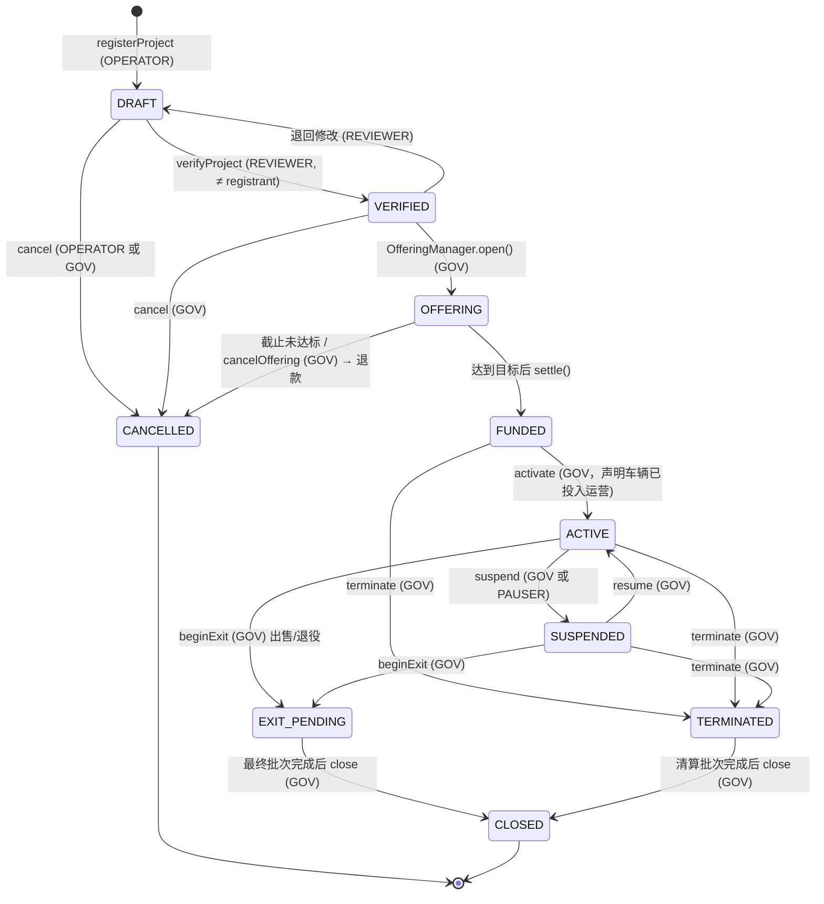
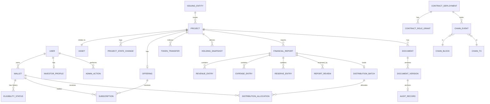

# RoboShare — 第一阶段分析（首项任务交付物）

状态：**供评审的草案。** 尚未编写、编译、测试或部署任何代码。本文档中的任何内容均未经过法律顾问、审计方或监管机构的审查。

本文档回答“首项任务”的十个事项。每一项都保持简短，并指向负责该主题的详细文档。

| # | 事项 | 详细文档 |
|---|------|-------------------|
| 1 | 产品需求分析 | 本文件 §1 |
| 2 | 系统架构 | [ARCHITECTURE.md](ARCHITECTURE.md) |
| 3 | 智能合约交互图 | 本文件 §3，[SMART_CONTRACT_SPEC.md](SMART_CONTRACT_SPEC.md) |
| 4 | 项目生命周期状态机 | 本文件 §4，[SMART_CONTRACT_SPEC.md §3](SMART_CONTRACT_SPEC.md) |
| 5 | 数据库 ER 设计 | 本文件 §5，[DATABASE_SCHEMA.md](DATABASE_SCHEMA.md) |
| 6 | 威胁模型 | [THREAT_MODEL.md](THREAT_MODEL.md) |
| 7 | 含里程碑的路线图 | [DEVELOPMENT_ROADMAP.md](DEVELOPMENT_ROADMAP.md) |
| 8 | 假设与待决事项 | 本文件 §8 |
| 9 | 建议的仓库结构 | 本文件 §9 |
| 10 | 启动所需的命令与工具 | 本文件 §10 |

---

## 0. 仓库检查

- 本项目未关联任何仓库，且第一阶段开始时共享项目文件夹为空。**不存在任何现有代码、依赖清单或配置**可供复用或需要协调。
- 第一阶段的产出位于共享项目文件夹的 `roboshare/` 下。其布局即为建议的仓库结构，因此一旦关联 GitHub 仓库即可原样提交。
- 当前工作区**未**安装 Foundry；已安装 Node 22 和 pnpm。下文列出的工具版本均尚未实际使用过。

## 1. 产品需求分析

### 1.1 RoboShare 是什么

一个用于发行、记录和管理针对单个 Robotaxi 车辆项目的**具有法律定义的投资权益**的平台。每个项目通过一个发行主体（SPV（特殊目的载体）或由法律顾问选定的其他载体）运作。在链上，每个项目拥有：

- 一个登记条目，包含文档哈希和生命周期状态，
- 一个限制转让的代币，硬上限为 **100 个整数单位（decimals = 0）**，
- 一次以 USDT（BEP20）出售这些单位的募集，
- 一系列分配批次，每个批次都与一份已批准的财务报告关联。

在链下，平台保存私有文档、合规数据、财务报告工作流以及链上状态的索引镜像。

### 1.2 用户及其任务

| 参与者 | 主要任务 | 信任级别 |
|---|---|---|
| 公众访客 | 浏览项目、文档（公开部分）、风险、白皮书 | 不受信任 |
| 投资者（合格钱包） | 通过投资资格审核、认购、持有、领取分配、核验报告 | 通过钱包（SIWE）认证 + 链下投资资格 |
| 运营方人员 | 登记项目、上传文档、提交财务报告、提议批次 | 特权角色，不能批准自己提交的内容 |
| 审核人 / 财务批准人 | 批准或拒绝报告和批次 | 特权角色，与运营方分离 |
| 合规代理 | 从 KYC 服务商推送投资资格状态 | 特权角色，范围限于身份登记 |
| 治理多签（+ 时间锁） | 授予角色、配置募集、解除暂停 | 最高级别；不能直接动用投资者资金 |
| 暂停者（守护者（Guardian）） | 仅限紧急暂停 | 范围窄 |
| 外部审计方 | 阅读报告、哈希、审计轨迹 | 只读 |

### 1.3 功能需求（精简版）

1. **项目登记**：唯一的项目 ID + 资产 ID、发行方引用、带版本的文档哈希、强制执行的生命周期。
2. **募集**：上线前配置（价格、上限 = 100、最低目标、时间窗口、支付资产），托管认购资金，结算（铸造代币 + 释放资金）或退款。
3. **代币**：兼容 ERC-20，decimals 为 0，上限不可更改，仅可由该项目的募集合约铸造，转让受投资资格和暂停状态约束。
4. **身份 / 合规**：按钱包设置投资资格，含有效期、撤销、司法管辖区/投资者类别代码，链上不存储 PII。
5. **分配**：按期间划分的分配批次，引用已批准报告的哈希，按每位持有人计算分档的运营方费用，主动领取（pull）模式，防止重复批次和重复领取，明确的尾差（dust）处理。
6. **审计登记**：仅追加的文档和报告哈希，修订与其所取代的记录相关联。
7. **Aave 适配器**：从 BNB Smart Chain（BSC）上经核实的 Aave V3 部署读取只读市场数据；MVP 中不提供交易路径。
8. **后端**：PostgreSQL schema、具有公开 / 投资者 / 管理员可见性层级的 REST API、支持链重组（reorg）处理的链上索引器、报告工作流、对账。
9. **前端**：公开页面、投资者仪表盘、项目详情、管理控制台。每个控件都接入真实逻辑。
10. **文档**：需求说明（master prompt）中列出的 15 份文档（全部交付于 `docs/` 中，另加 `README.md`）。

### 1.4 非功能需求

- 安全优先于速度；合约默认不可升级。
- 源代码中不含任何密钥；配置基于环境变量；生产配置中不使用占位地址。
- 数据库中源自链上的每一条事实都必须能与链上状态对账。
- 隐私层级在服务端强制执行，而不只是在 UI 中。
- 无障碍（目标 WCAG 2.1 AA）和移动端响应式。
- 如实标注：模拟实现标注为 TEST-ONLY，预测数据绝不显示为实际数据，人工录入的数据绝不标注为“已审计”。

### 1.5 分析中发现的安全关键决策

这些决策会影响合约代码，并在 §8 中连同默认方案一并列出：

- 代币的法律性质（股权 vs. 合同性经济权利 vs. 债务）——影响转让规则、恢复和披露。
- 费率档位和分配资格的快照规则。
- 丢失密钥持仓的恢复（强制转让）。
- 部分成交的募集 vs. 全有或全无（影响“1 单位 = 1%”的含义）。
- 谁可以持有资金以及何时持有（托管 → 发行方金库）。
- 支付稳定币的选择及其在 BNB Smart Chain（BSC）上的 decimals。

## 2. 系统架构（摘要）

完整内容：[ARCHITECTURE.md](ARCHITECTURE.md)。



关键选择：
- **后端：NestJS**（独立的 API 进程和 worker 进程共享模块），而非 Next.js 服务端路由，原因是索引、对账和报告处理都是长时间运行的任务，不应放在请求/边缘运行时中，并且 NestJS 提供的 guard/依赖注入适合三个可见性层级。
- **使用 Redis 是合理的**，用于 BullMQ 任务队列（索引器、报告哈希计算、对账、通知）以及公开读取的短 TTL 缓存。它绝不作为事实来源。
- **Monorepo**（pnpm workspaces + Turborepo），使 ABI 和类型只生成一次并共享使用。

## 3. 智能合约交互图



主要调用序列（认购、结算、分配、领取）见 [SMART_CONTRACT_SPEC.md §9](SMART_CONTRACT_SPEC.md)。

## 4. 项目生命周期状态机



规则（由链上显式的状态转换表强制执行）：
- 状态转换是**授权角色作出的声明/证明（attestation）**，绝不能证明车辆已被购买、投保或取得牌照。每次转换都带有一个 `reasonHash`，指向 AuditRegistry 中的证据文档。
- `CANCELLED` 和 `CLOSED` 为终止状态。一旦离开 `OFFERING`，任何转换都不能重新进入该状态。
- 代币转让仅在 `FUNDED` 和 `ACTIVE` 状态下允许。在 `SUSPENDED`、`EXIT_PENDING`、`TERMINATED` 和 `CLOSED` 状态下冻结转让，以使最终持有人集合保持稳定（决策 D-12）。
- 分配可在 `ACTIVE`、`EXIT_PENDING` 和 `TERMINATED`（清算收益）状态下提议。

## 5. 数据库实体关系设计（摘要）

包含列、键和索引的完整 schema：[DATABASE_SCHEMA.md](DATABASE_SCHEMA.md)。



私有合规数据（服务商引用、司法管辖区、合格投资者证明材料指针）保存在独立的 `compliance` schema 中，采用列级加密并拥有自己的数据库角色；公开 API 进程对其没有任何授权。

## 6. 威胁模型（摘要）

完整模型：[THREAT_MODEL.md](THREAT_MODEL.md)。主要风险（按优先级排序）：

1. **治理密钥被攻破** → 未经授权的角色授予或配置变更。缓解措施：Safe 多签 + 时间锁、角色分离、任何角色都不能同时提议和批准、监控 `RoleGranted`。
2. **欺诈性或错误的财务报告**导致错误分配。缓解措施：双人规则（提交人 ≠ 审核人，在链上强制执行）、报告哈希先于批次锚定、批次金额受报告中可分配数额的约束、资金仅从明确指定的出资方拉取。
3. **绕过投资资格**（转让给不合格钱包、KYC 过期）。缓解措施：代币的 `_update` hook 对双方均查询 IdentityRegistry（包括有效期）；铸造路径同样检查。
4. **分配记账缺陷**（重复领取、舍入、档位计算错误）。缓解措施：在创建批次时一次性在链上计算分配额、`claimed` 位图、不变量测试 Σ分配额 + 费用 + 尾差（dust）= 金额。
5. OfferingManager 中的**托管资金损失**。缓解措施：按每笔认购记账、主动领取（pull）退款、nonReentrant、SafeERC20、结算前管理员不得提取资金。
6. **索引器偏差 / 链重组（reorg）** 导致显示错误余额。缓解措施：确认深度、区块哈希父块检查、回滚、定期对照 `balanceOf` 对账。
7. **链下数据泄露**（PII、私有文档）。缓解措施：独立 schema、加密、签名的短时效 URL、访问审计日志。
8. **虚假陈述风险**（UI 将预测数据显示为实际数据、暗示拥有车辆所有权）。缓解措施：schema 中带类型的 `figureKind`（ACTUAL/PROJECTED）、文案审查、每个项目的法律权利摘要。

## 7. 开发路线图（摘要）

完整路线图：[DEVELOPMENT_ROADMAP.md](DEVELOPMENT_ROADMAP.md)。

| 里程碑 | 范围 | 退出标准 |
|---|---|---|
| M0 第一阶段 | 文档、架构、威胁模型 | **本次评审** |
| M1 第二阶段 | 核心合约 + Foundry 测试（单元、模糊、不变量） | `forge test` 全部通过、覆盖率报告、Slither 结果已分类处理 |
| M2 第三阶段 | 数据库、API、索引器、报告流水线、对账 | API 测试全部通过；索引器能在 anvil 上经受模拟链重组（reorg） |
| M3 第四阶段 | Web 应用：公开、投资者、管理员 | 针对本地 anvil + API 的 Playwright 端到端测试 |
| M4 第五阶段 | Aave 只读适配器 | 地址已对照官方来源核实；针对 BSC 分叉的读取测试 |
| M5 第六阶段 | 安全检查、测试网部署（链 97）、部署指南 | 测试网部署已在区块浏览器上验证；安全审查报告 |
| M6 | 外部审计 + 法律签核 | 不在本代码库范围内；主网上线的前提条件 |

## 8. 假设与待决事项

图例：**[A]** 表示我们据以构建的假设，**[D]** 表示需要作出的决策，并附上除非另有指示否则将实施的默认方案。标有 ⚠ 的事项会实质性影响安全性或代币的法律含义。

### 假设

- A-1 运营方将为每个项目设立一个发行主体（或一个系列主体）。合约仅存储一个不透明的 `issuerId` 和设立文件的哈希。
- A-2 不存在经授权的 Tesla 运营数据 API。运营数据通过带有 schema 和审核步骤的**人工报告**录入。不会编写任何 Tesla 集成。
- A-3 所有项目统一使用 BSC 上的 USDT（BEP20）入金和分配（D-22）。合约地址与 decimals 在部署时从链上核实，不在代码中假定。
- A-4 每个项目的持有人少于约 100 个（上限为 100 个整数单位），这使得在链上按持有人计算分配额的成本可以承受。
- A-5 开发使用 BNB Smart Chain（BSC）测试网（链 ID 97）；主网（链 ID 56）仅在审计并获得明确批准后使用。
- A-6 Aave V3 已部署在 BNB Smart Chain（BSC）上。Pool、PoolDataProvider、Oracle 地址及上架资产将取自官方 Aave 地址簿和治理记录，并在使用前于链上交叉核对。本阶段不硬编码任何地址。
- A-7 车辆价格、收益、地点或与 Tesla 的关系均未知。文档中所有示例数字均标注为示意性数据。

### 决策（含默认方案）

| ID | 问题 | 我们将实施的默认方案 | ⚠ |
|---|---|---|---|
| D-1 | 代币的法律性质：SPV（特殊目的载体）股权、合同性经济权利（利润参与），还是债务？ | ✅ 已确认（2026-10-09）：**获得项目可分配利润份额的合同性经济权利**，由每个项目的权益文件（Rights Document）定义，其哈希存储于链上。不主张车辆所有权。 | ⚠ |
| D-2 | 代币标准 | ✅ 已确认（2026-10-09）：**采用 ERC-3643 启发式拆分的限制转让 ERC-20（OpenZeppelin v5）**（代币 / IdentityRegistry / 合规检查），而非完整的 T-REX/ONCHAINID。理由：需审计的范围更小、标准 ERC-20 接口、decimals 为 0；受限时转让会 revert，这符合 ERC-20 规范，但必须予以披露。如受监管的过户代理要求，仍可选择完整的 ERC-3643。 | ⚠ |
| D-3 | 每个项目一个代币，还是所有项目共用一个多代币合约（ERC-1155）？ | **每个项目一个 ERC-20**，由工厂合约部署（不可升级）。在结构上即实现记账分离；钱包可标准显示。 | |
| D-4 | 募集成交规则 | ✅ 已确认（2026-10-09）：**允许部分募集。** 每次募集在启动前由治理设定最低成交单位数 `minUnits`（1–100）。截止时达到 `minUnits` 即成功结算，未售出的单位永不铸造（MVP 不支持追加募集）；未达到则全额退款。分配按**已发行**单位按比例进行，因此只有卖满 100 单位时才是“1 单位 = 1%”，否则每单位 = 资金池的 1/已发行单位数。 | ⚠ |
| D-5 | 代币何时铸造？ | **在结算时**，而非认购时。认购资金为托管的稳定币；结算时重新检查投资资格。 | |
| D-6 | 费率档位依据 | **按车辆项目**，依据持有人**在批次快照时点**的余额。不按整个投资组合计算。 | |
| D-7 | 快照时点 | ✅ 已确认（2026-10-09）：**报告期末**，以提议批次时记录的区块号表示（必须 ≤ 当前区块）。余额从代币检查点（checkpoint）读取。期间内的转让无关紧要；只看快照余额。 | ⚠ |
| D-8 | 费用基数 | ✅ 已确认（2026-10-09）：**只收分档费率，不另收管理费。** 运营方费用适用于每位持有人在**法律定义的可分配利润**中的总份额（扣除实际运营成本、储备金、优先义务及适用的税费之后）。运营方不在可分配利润之前另收管理费或平台费；第三方实际发生的费用仍作为运营成本列入报告。 | ⚠ |
| D-9 | 亏损 | 可分配利润为零或为负的期间不创建批次；运营方费用为零。亏损结转属于有待定义的法律/会计规则；默认方案：不假定存在结转。 | |
| D-10 | 舍入 | 每位持有人：`gross = floor(D·u/U)`，`fee = floor(gross·bps/10000)`，`net = gross − fee`（在费用拆分上舍入有利于投资者）。尾差（dust）`D − Σgross` **结转**至该项目的下一个批次，并在链上记录。进入 `CLOSED` 时，剩余尾差转入发行方金库并发出事件。 | |
| D-11 | 分配方式 | **链上计算，主动领取（pull）。** 提议时运营方传入已排序的持有人列表；合约核验 Σ快照余额 = 快照总供应量，计算并存储分配额，然后由投资者领取。为方便起见，支持混合推送（由运营方调用 `claimFor`，资金仍转给持有人）。 | |
| D-12 | 按生命周期状态的转让规则 | 仅在 `FUNDED` 和 `ACTIVE` 状态下允许。在所有其他状态下冻结。 | |
| D-13 | 领取资格 | ✅ 已确认（2026-10-09）：持有人的应得额在快照时确定。**领取要求钱包未被冻结**（制裁/撤销）；未领取的金额保留在合约中，绝不会被划转给运营方。投资资格已过期但未被撤销的钱包仍可领取。 | ⚠ |
| D-14 | 丢失密钥恢复 | ✅ 已确认（2026-10-09）：**不提供找回功能。** 合约中没有 `forcedTransfer` 和 `RECOVERY_ROLE`，任何角色都无法移动投资人的代币。丢失私钥即永久失去对应单位及其分配，需在风险披露中明确说明。 | ⚠ |
| D-15 | 可升级性 | 合约**不可升级**。修复以新部署的形式发布，并附有文档化的迁移方案（仅适用于新项目；现有代币保持不变）。 | |
| D-16 | 治理 | ✅ 已确认（2026-10-09）：Safe **2-of-3** 多签 → OpenZeppelin `TimelockController`（**24 小时**延迟）持有 `DEFAULT_ADMIN_ROLE`。独立的守护者（Guardian）Safe 仅持有 `PAUSER_ROLE`。解除暂停需要治理。 | ⚠ |
| D-17 | 投资资格模型 | 钱包 → `{status, investorClass, jurisdictionCode, expiresAt}`；不含 PII。开发环境中的模拟服务商标注为 **TEST-ONLY**，并在 `CHAIN_ID=56` 时拒绝运行。真实服务商待定。 | |
| D-18 | 跨链 | MVP 中不支持。代币不提供跨链桥铸造接口。仅在文档中描述 `ICrossChainGateway` 接口。 | |
| D-19 | 二级交易 | MVP 中不提供交易市场。仅支持合格钱包之间的点对点转让（不在 DEX 上架；DEX 资金池无论如何都无法通过投资资格检查）。 | |
| D-20 | 由谁为批次出资 | 由明确指定的 `funder` 地址（发行方金库 Safe）授权稳定币额度；合约精确拉取 `amount`。金额必须 ≤ 已批准报告的 `distributableAmount` 减去该报告此前各批次的金额。 | |
| D-21 | 暂停阻止哪些操作 | ✅ 已确认（2026-10-09）：暂停会阻止认购、结算、转让、领取**以及退款**，以在漏洞利用期间阻止资金被耗尽。由于这同样会阻止投资者退出，暂停应只维持必要的时间，并建议由法律顾问复核。 | ⚠ |
| D-22 | 入金币种 | ✅ 已确认（2026-10-09）：**所有项目统一使用 USDT（BEP20）** 认购、退款和分配。BSC 主网 USDT 合约（常用地址 `0x55d398326f99059fF775485246999027B3197955`，名称 Binance-Peg BSC-USD）及其 decimals 必须在部署前于链上和 BscScan 核实后才写入配置；本环境暂时无法访问 BSC 节点，尚未核实。BSC 测试网没有官方 USDT，测试网使用标注 **TEST-ONLY** 的模拟 USDT。 | ⚠ |
| D-23 | 一次授权、直接购买 | ✅ 已确认（2026-10-09）：新增单例 `SubscriptionRouter`：用户首次购买时对它授权一次 USDT，之后在任何项目中只需选择份额，一笔交易完成认购。路由合约只从调用者本人拉取精确金额，直接转入该项目托管合约，自身不持有资金。授权额度由用户填写（预填本次金额，可调高），默认不提供无限授权，并提供撤销授权按钮。 | ⚠ |

## 9. 建议的仓库结构

```text
roboshare/
├── README.md
├── docs/                         # Phase 1 (this delivery)
│   ├── PHASE1_ANALYSIS.md
│   ├── ARCHITECTURE.md  DEVELOPMENT_ROADMAP.md  WHITEPAPER.md  TOKENOMICS.md
│   ├── SMART_CONTRACT_SPEC.md  SECURITY_MODEL.md  THREAT_MODEL.md
│   ├── API_SPEC.md  DATABASE_SCHEMA.md  DEPLOYMENT_GUIDE.md  TESTING_GUIDE.md
│   └── ADMIN_OPERATIONS.md  RISK_DISCLOSURES.md  INCIDENT_RESPONSE.md
├── contracts/                    # Foundry project (Phase 2)
│   ├── foundry.toml
│   ├── src/
│   │   ├── registry/AssetRegistry.sol
│   │   ├── registry/AuditRegistry.sol
│   │   ├── identity/IdentityRegistry.sol
│   │   ├── token/RwaShareToken.sol
│   │   ├── offering/OfferingManager.sol
│   │   ├── offering/SubscriptionRouter.sol
│   │   ├── distribution/RevenueDistributor.sol
│   │   ├── factory/ProjectFactory.sol
│   │   ├── defi/AaveReader.sol          # Phase 5, view-only
│   │   ├── interfaces/                  # incl. ICrossChainGateway (doc-only)
│   │   └── libraries/FeeTiers.sol
│   ├── test/{unit,integration,fuzz,invariant}/
│   ├── test/mocks/                      # TEST-ONLY mocks
│   └── script/                          # Deploy*.s.sol
├── apps/
│   ├── web/                      # Next.js (App Router), Tailwind, wagmi/viem
│   ├── api/                      # NestJS HTTP API
│   └── worker/                   # NestJS standalone: indexer, reports, reconciler
├── packages/
│   ├── db/                       # Prisma schema + migrations
│   ├── shared/                   # zod schemas, types, fee math (TS mirror)
│   ├── contracts-abi/            # generated ABIs + typed addresses per chain
│   └── config/                   # eslint, tsconfig, tailwind presets
├── infra/
│   ├── docker-compose.yml        # postgres, redis, minio, anvil
│   └── deployments/{97,56}.json  # filled only from real deployments
├── .github/workflows/            # contracts.yml, app.yml, security.yml
├── .env.example                  # names only, no values
├── pnpm-workspace.yaml
└── turbo.json
```

## 10. 启动开发的命令与工具

以下版本为安装时需要锁定的目标版本；在本工作区中均尚未安装或运行。

| 工具 | 用途 | 安装 |
|---|---|---|
| Foundry（forge、cast、anvil、chisel） | 编译、测试、模糊测试、不变量测试、脚本、本地链 | `curl -L https://foundry.paradigm.xyz \| bash && foundryup`（使用 `foundryup --install <version>` 锁定某个发行版本） |
| Solidity 0.8.x（锁定精确版本，例如启动时的最新稳定版） | 编译器 | 通过 `foundry.toml` 的 `solc_version` |
| OpenZeppelin Contracts 5.x（锁定标签） | AccessControl、ERC20、Pausable、ReentrancyGuard、SafeERC20、Checkpoints、TimelockController | `forge install OpenZeppelin/openzeppelin-contracts@v5.<x>.<y>` |
| Node.js 22 LTS + pnpm 9+ | monorepo | 本工作区中已具备 |
| Docker + Compose | Postgres 16、Redis 7、MinIO、anvil | Docker Desktop / engine |
| Slither（Python） | 静态分析 | `pipx install slither-analyzer` |
| Aderyn（可选） | 第二个静态分析器 | `cargo install aderyn` 或发行版二进制文件 |
| solhint | Solidity 代码检查 | `pnpm add -D solhint` |
| Prisma | ORM + 迁移 | `pnpm add -D prisma && pnpm add @prisma/client` |
| Vitest、Testing Library、Playwright | 前端/API 测试 | `pnpm add -D vitest @testing-library/react @playwright/test` |
| Safe{Wallet} + TimelockController | 测试网上的治理 | UI + 脚本 |

第二阶段的初始化步骤（获批后执行）：

```bash
mkdir -p roboshare && cd roboshare
git init
pnpm init && printf "packages:\n  - apps/*\n  - packages/*\n" > pnpm-workspace.yaml
forge init contracts --no-commit
cd contracts
forge install OpenZeppelin/openzeppelin-contracts@<pinned-tag> --no-commit
forge build
forge test -vvv
slither . --filter-paths "lib|test"
```

本地技术栈（第三阶段及以后）：

```bash
docker compose -f infra/docker-compose.yml up -d   # postgres, redis, minio, anvil
pnpm install
pnpm --filter db prisma migrate dev
pnpm --filter api dev
pnpm --filter worker dev
pnpm --filter web dev
```

---

**下一步：** §8 中标 ⚠ 的决策已于 2026-10-09 全部确认。第二阶段将通过 `forge init` 以及 AssetRegistry + IdentityRegistry + RwaShareToken 核心合约启动第二阶段。
