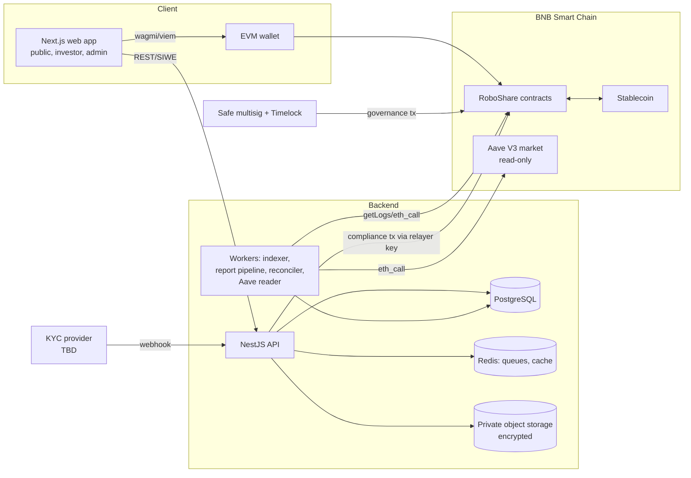
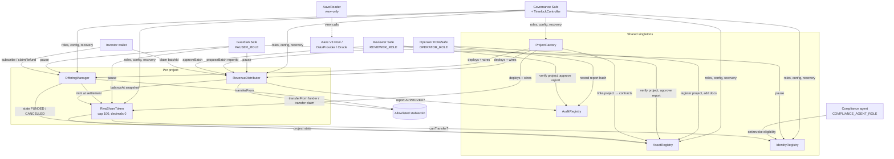
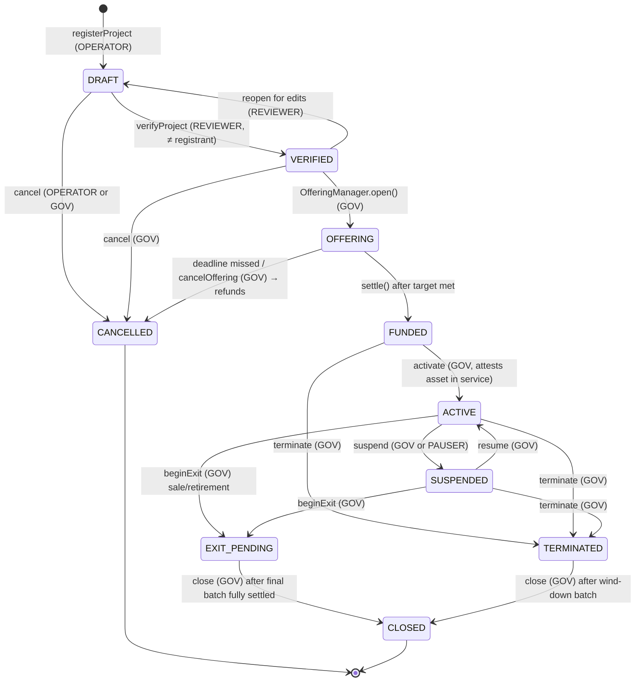
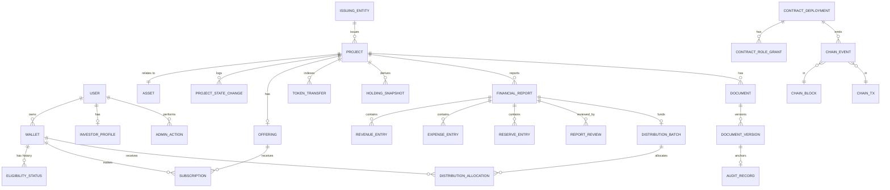

# RoboShare — Phase 1 Analysis (First Task Deliverable)

Status: **DRAFT for review.** No code has been written, compiled, tested, or deployed. Nothing in this document has been reviewed by counsel, an auditor, or a regulator.

This document answers the ten "First Task" items. Each item is short and points to the detailed document that owns the topic.

| # | Item | Detailed document |
|---|------|-------------------|
| 1 | Product requirements analysis | this file §1 |
| 2 | System architecture | [ARCHITECTURE.md](ARCHITECTURE.md) |
| 3 | Smart contract interaction diagram | this file §3, [SMART_CONTRACT_SPEC.md](SMART_CONTRACT_SPEC.md) |
| 4 | Project lifecycle state machine | this file §4, [SMART_CONTRACT_SPEC.md §2](SMART_CONTRACT_SPEC.md#2-assetregistry) |
| 5 | Database ER design | this file §5, [DATABASE_SCHEMA.md](DATABASE_SCHEMA.md) |
| 6 | Threat model | [THREAT_MODEL.md](THREAT_MODEL.md) |
| 7 | Roadmap with milestones | [DEVELOPMENT_ROADMAP.md](DEVELOPMENT_ROADMAP.md) |
| 8 | Assumptions and unresolved decisions | this file §8 |
| 9 | Proposed repository structure | this file §9 |
| 10 | Commands and tools to start | this file §10 |

---

## 0. Repository inspection

- No repository is attached to this project and the shared project folder was empty when Phase 1 started. There is **no existing code, dependency manifest, or configuration** to reuse or reconcile.
- Phase 1 output lives in the shared project folder under `roboshare/`. It is laid out as the proposed repository so it can be committed as-is once a GitHub repository is attached.
- Foundry is **not** installed in the current workspace; Node 22 and pnpm are. No tool version below has been exercised yet.

## 1. Product requirements analysis

### 1.1 What RoboShare is

A platform that issues, records, and services **legally defined investment interests** in individual Robotaxi vehicle projects. Each project is run through an issuing entity (SPV or other vehicle chosen by counsel). On-chain, each project gets:

- a registry entry with document hashes and a lifecycle state,
- one restricted-transfer token with a hard cap of **100 whole units (decimals = 0)**,
- an offering that sells those units against a stablecoin,
- a sequence of distribution batches, each tied to an approved financial report.

Off-chain, the platform holds private documents, compliance data, financial report workflows, and an indexed mirror of chain state.

### 1.2 Users and their jobs

| Actor | Primary jobs | Trust level |
|---|---|---|
| Public visitor | Browse projects, documents (public set), risks, whitepaper | Untrusted |
| Investor (eligible wallet) | Pass eligibility, subscribe, hold, claim distributions, verify reports | Authenticated by wallet (SIWE) + off-chain eligibility |
| Operator staff | Register projects, upload documents, submit financial reports, propose batches | Privileged, cannot approve own submissions |
| Reviewer / finance approver | Approve or reject reports and batches | Privileged, separate from operator |
| Compliance agent | Push eligibility status from a KYC provider | Privileged, scoped to identity registry |
| Governance multisig (+ timelock) | Grant roles, configure offerings, recovery, unpause | Highest; no direct access to investor funds |
| Pauser (guardian) | Emergency pause only | Narrow |
| External auditor | Read reports, hashes, audit trail | Read-only |

### 1.3 Functional requirements (condensed)

1. **Project registry**: unique project ID + asset ID, issuer reference, document hashes with versions, enforced lifecycle.
2. **Offering**: configure before launch (price, cap = 100, min target, window, payment asset), escrow subscriptions, settle (mint + release funds) or refund.
3. **Token**: ERC-20-compatible, decimals 0, immutable cap, mint only by the project's offering contract, transfers gated by eligibility and pause.
4. **Identity / compliance**: per-wallet eligibility with expiry, revocation, jurisdiction/investor-class code, no PII on-chain.
5. **Distributions**: per-period batches referencing an approved report hash, tiered operator fee computed per holder, pull claims, duplicate batch and duplicate claim prevention, explicit dust handling.
6. **Audit registry**: append-only hashes of documents and reports with amendments linked to the record they supersede.
7. **Aave adapter**: read-only market data from a verified Aave V3 deployment on BNB Smart Chain; no transactional path in the MVP.
8. **Backend**: PostgreSQL schema, REST API with public / investor / admin visibility tiers, chain indexer with reorg handling, report workflow, reconciliation.
9. **Frontend**: public pages, investor dashboard, project detail, admin console. Every control is wired to real logic.
10. **Docs**: 15 documents listed in the master prompt (all delivered in `docs/` plus `README.md`).

### 1.4 Non-functional requirements

- Security over speed; non-upgradeable contracts by default.
- No secrets in source; environment-based config; no placeholder addresses in production config.
- Every DB fact derived from chain must be reconcilable with chain state.
- Privacy tiers enforced server-side, not just in the UI.
- Accessibility (WCAG 2.1 AA target) and mobile responsiveness.
- Honest labelling: mocks marked TEST-ONLY, projections never shown as actuals, manual data never labelled "audited".

### 1.5 Security-critical decisions surfaced by the analysis

These shape contract code and are listed with defaults in §8:

- Legal nature of the token (equity vs. contractual economic right vs. debt) — affects transfer rules, recovery, and disclosures.
- Snapshot rule for fee tiers and distribution eligibility.
- Recovery (forced transfer) of lost-key positions.
- Partial-fill offerings vs. all-or-nothing (affects what "1 unit = 1%" means).
- Who may hold funds and when (escrow → issuer treasury).
- Payment stablecoin choice and its decimals on BNB Smart Chain.

## 2. System architecture (summary)

Full detail: [ARCHITECTURE.md](ARCHITECTURE.md).



Key choices:
- **Backend: NestJS** (separate API and worker processes sharing modules) over Next.js server routes, because indexing, reconciliation and report processing are long-running jobs that should not live inside a request/edge runtime, and because NestJS gives guards/DI suited to the three visibility tiers.
- **Redis is justified** for BullMQ job queues (indexer, report hashing, reconciliation, notifications) and short-TTL caching of public reads. It is never a source of truth.
- **Monorepo** (pnpm workspaces + Turborepo) so ABIs and types are generated once and shared.

## 3. Smart contract interaction diagram



Main call sequences (subscription, settlement, distribution, claim) are in [SMART_CONTRACT_SPEC.md §9](SMART_CONTRACT_SPEC.md#9-interaction-sequences).

## 4. Project lifecycle state machine



Rules (enforced on-chain by an explicit transition table):
- A transition is an **attestation by an authorized role**, never proof that a vehicle was bought, insured, or licensed. Every transition carries a `reasonHash` pointing at the evidence document in the AuditRegistry.
- `CANCELLED` and `CLOSED` are terminal. No transition re-enters `OFFERING` once left.
- Token transfers are allowed in `FUNDED` and `ACTIVE` only. They are frozen in `SUSPENDED`, `EXIT_PENDING`, `TERMINATED` and `CLOSED` so the final holder set is stable (decision D-12).
- Distributions can be proposed in `ACTIVE`, `EXIT_PENDING`, and `TERMINATED` (wind-down proceeds).

## 5. Database entity relationship design (summary)

Full schema with columns, keys, and indexes: [DATABASE_SCHEMA.md](DATABASE_SCHEMA.md).



Private compliance data (provider reference, jurisdiction, accreditation evidence pointer) is held in a separate `compliance` schema with column encryption and its own DB role; the public API process has no grant on it.

## 6. Threat model (summary)

Full model: [THREAT_MODEL.md](THREAT_MODEL.md). Top risks, ranked:

1. **Governance key compromise** → unauthorized role grants or recovery transfers. Mitigation: Safe multisig + timelock, role separation, no role can both propose and approve, monitoring of `RoleGranted`.
2. **Fraudulent or wrong financial report** leading to wrong distributions. Mitigation: two-person rule (submitter ≠ reviewer, enforced on-chain), report hash anchored before batch, batch amount bounded by report's distributable figure, funds pulled only from an explicit funder.
3. **Eligibility bypass** (transfer to non-eligible wallet, stale KYC). Mitigation: token `_update` hook checks IdentityRegistry for both parties incl. expiry; mint path checks too.
4. **Distribution accounting bugs** (double claim, rounding, tier miscalc). Mitigation: on-chain allocation computed once at batch creation, `claimed` bitmap, invariant tests Σallocations + fees + dust = amount.
5. **Escrow loss** in OfferingManager. Mitigation: per-subscription accounting, pull refunds, nonReentrant, SafeERC20, no admin withdraw before settlement.
6. **Indexer divergence / reorgs** showing wrong balances. Mitigation: confirmation depth, block-hash parent check, rollback, scheduled reconciliation against `balanceOf`.
7. **Off-chain data leak** (PII, private docs). Mitigation: separate schema, encryption, signed short-lived URLs, audit log on access.
8. **Misrepresentation risk** (UI shows projections as actuals, implies vehicle ownership). Mitigation: typed `figureKind` (ACTUAL/PROJECTED) in schema, copy review, legal rights summary per project.

## 7. Development roadmap (summary)

Full roadmap: [DEVELOPMENT_ROADMAP.md](DEVELOPMENT_ROADMAP.md).

| Milestone | Scope | Exit criteria |
|---|---|---|
| M0 Phase 1 | Docs, architecture, threat model | **This review** |
| M1 Phase 2 | Core contracts + Foundry tests (unit, fuzz, invariant) | `forge test` green, coverage report, Slither triaged |
| M2 Phase 3 | DB, API, indexer, report pipeline, reconciliation | API tests green; indexer survives simulated reorg on anvil |
| M3 Phase 4 | Web app: public, investor, admin | Playwright E2E against local anvil + API |
| M4 Phase 5 | Aave read-only adapter | Addresses verified against official sources; read tests against BSC fork |
| M5 Phase 6 | Security pass, testnet deploy (chain 97), deployment guide | Testnet deployment verified on explorer; security review report |
| M6 | External audit + legal sign-off | Outside this codebase; prerequisite for mainnet |

## 8. Assumptions and unresolved decisions

Legend: **[A]** assumption we build on, **[D]** decision needed, with the default we will implement unless told otherwise. Items marked ⚠ materially affect security or the legal meaning of the token.

### Assumptions

- A-1 The operator will form an issuing entity per project (or a series entity). The contract stores only an opaque `issuerId` and a hash of the formation documents.
- A-2 No authorized Tesla operating-data API is available. Operating data enters through **manual reporting** with a schema and a review step. No Tesla integration will be written.
- A-3 Payment is in one allowlisted stablecoin per offering on BNB Smart Chain. Which one, and its decimals, is verified at configuration time (BEP-20 stablecoins on BSC commonly use 18 decimals, but this must be read from the token contract, not assumed).
- A-4 Fewer than ~100 holders per project (cap is 100 whole units), which makes on-chain per-holder allocation affordable.
- A-5 BNB Smart Chain testnet (chain ID 97) for development; mainnet (chain ID 56) only after audit and explicit approval.
- A-6 Aave V3 is deployed on BNB Smart Chain. Pool, PoolDataProvider, Oracle addresses and listed assets will be taken from the official Aave address book and governance records and cross-checked on-chain before use. No address is hard-coded in this phase.
- A-7 No vehicle prices, returns, locations, or Tesla relationships are known. All example numbers in docs are labelled illustrative.

### Decisions (with defaults)

| ID | Question | Default we will implement | ⚠ |
|---|---|---|---|
| D-1 | Legal nature of the token: SPV equity, contractual economic right (profit participation), or debt? | **Contractual economic right to a share of the project's distributable profit**, defined by a per-project Rights Document whose hash is stored on-chain. No claim of vehicle ownership. | ⚠ |
| D-2 | Token standard | **Restricted-transfer ERC-20 (OpenZeppelin v5) with an ERC-3643-inspired split** (token / IdentityRegistry / compliance checks), not full T-REX/ONCHAINID. Reason: smaller audited surface, standard ERC-20 interface, decimals 0; transfers revert when restricted, which is ERC-20-conformant behaviour but must be disclosed. Full ERC-3643 remains an option if a regulated transfer agent requires it. | ⚠ |
| D-3 | One token per project, or one multi-token (ERC-1155) for all projects? | **One ERC-20 per project**, deployed by a factory (non-upgradeable). Separate accounting by construction; standard wallet display. | |
| D-4 | Offering fill rule | **All-or-nothing for 100 units.** If fewer than 100 units are subscribed by the deadline, everyone is refunded. Keeps "1 unit = 1% of the pool" true. A configurable minimum < 100 is supported in code but disabled by default. | ⚠ |
| D-5 | When are tokens minted? | **At settlement**, not at subscription. Subscriptions are escrowed stablecoin; eligibility is rechecked at settlement. | |
| D-6 | Fee tier basis | **Per vehicle project**, based on the holder's balance **at the batch snapshot timepoint**. Not portfolio-wide. | |
| D-7 | Snapshot timepoint | The **end of the reporting period** as a block number recorded when the batch is proposed (must be ≤ current block). Balances read from token checkpoints. Transfers during the period do not matter; only the snapshot balance. | ⚠ |
| D-8 | Fee base | Operator fee applies to each holder's gross share of the **legally defined distributable profit** (after costs, reserves, priority obligations, taxes where applicable). Separate management fees, if any, are deducted off-chain before distributable profit and must be disclosed in the report. | ⚠ |
| D-9 | Losses | No batch is created for a period with zero or negative distributable profit; operator fee is zero. Loss carry-forward is a legal/accounting rule to be defined; default: none assumed. | |
| D-10 | Rounding | Per holder: `gross = floor(D·u/U)`, `fee = floor(gross·bps/10000)`, `net = gross − fee` (rounding favours investors on the fee split). Dust `D − Σgross` is **carried forward** to the project's next batch, recorded on-chain. On `CLOSED`, residual dust goes to the issuer treasury with an event. | |
| D-11 | Distribution style | **On-chain computed, pull-claimed.** At proposal the operator passes the sorted holder list; the contract verifies Σ snapshot balances = snapshot supply, computes and stores allocations, then investors claim. Hybrid push (`claimFor` by operator, funds still go to the holder) supported for convenience. | |
| D-12 | Transfers by lifecycle state | Allowed in `FUNDED` and `ACTIVE` only. Frozen in all other states. | |
| D-13 | Claim eligibility | A holder's entitlement is fixed at snapshot. **Claiming requires the wallet not to be frozen** (sanctions/revocation); unclaimed amounts stay in the contract and are never swept to the operator. Expired-but-not-revoked eligibility may still claim. | ⚠ |
| D-14 | Lost-key recovery | **Included, disabled by default**: `forcedTransfer` behind `RECOVERY_ROLE` held by the governance Safe through the timelock, requiring a recovery-evidence hash and emitting an event. Enable per project only if the Rights Document permits it. | ⚠ |
| D-15 | Upgradeability | **Non-upgradeable** contracts. Fixes ship as new deployments with a documented migration (only possible for new projects; existing tokens remain). | |
| D-16 | Governance | Safe multisig (threshold to be chosen, suggested ≥ 3-of-5) → OpenZeppelin `TimelockController` (suggested 48h) holds `DEFAULT_ADMIN_ROLE`. Separate guardian Safe holds `PAUSER_ROLE` only. Unpause requires governance. | ⚠ |
| D-17 | Eligibility model | Wallet → `{status, investorClass, jurisdictionCode, expiresAt}`; no PII. Mock provider in dev is labelled **TEST-ONLY** and refuses to run when `CHAIN_ID=56`. Real provider TBD. | |
| D-18 | Cross-chain | None in MVP. Token exposes no bridge mint. An `ICrossChainGateway` interface is documented only. | |
| D-19 | Secondary trading | No marketplace in MVP. Peer-to-peer transfers between eligible wallets only (no DEX listing; DEX pools would fail eligibility checks anyway). | |
| D-20 | Who funds a batch | An explicit `funder` address (issuer treasury Safe) approves the stablecoin; contract pulls exactly `amount`. Amount must be ≤ the approved report's `distributableAmount` minus prior batches for that report. | |
| D-21 | What a pause blocks | Pause blocks subscriptions, settlement, transfers, claims **and refunds**, to stop drains during an exploit. Because this also blocks investor exits, counsel should confirm; the alternative is to leave refunds/claims open while paused. | ⚠ |

## 9. Proposed repository structure

```text
roboshare/
├── README.md
├── docs/                         # Phase 1 (this delivery)
│   ├── PHASE1_ANALYSIS.md
│   ├── ARCHITECTURE.md  DEVELOPMENT_ROADMAP.md  WHITEPAPER.md  TOKENOMICS.md
│   ├── SMART_CONTRACT_SPEC.md  SECURITY_MODEL.md  THREAT_MODEL.md
│   ├── API_SPEC.md  DATABASE_SCHEMA.md  DEPLOYMENT_GUIDE.md  TESTING_GUIDE.md
│   └── ADMIN_OPERATIONS.md  RISK_DISCLOSURES.md  INCIDENT_RESPONSE.md
├── contracts/                    # Foundry project (Phase 2)
│   ├── foundry.toml
│   ├── src/
│   │   ├── registry/AssetRegistry.sol
│   │   ├── registry/AuditRegistry.sol
│   │   ├── identity/IdentityRegistry.sol
│   │   ├── token/RwaShareToken.sol
│   │   ├── offering/OfferingManager.sol
│   │   ├── distribution/RevenueDistributor.sol
│   │   ├── factory/ProjectFactory.sol
│   │   ├── defi/AaveReader.sol          # Phase 5, view-only
│   │   ├── interfaces/                  # incl. ICrossChainGateway (doc-only)
│   │   └── libraries/FeeTiers.sol
│   ├── test/{unit,integration,fuzz,invariant}/
│   ├── test/mocks/                      # TEST-ONLY mocks
│   └── script/                          # Deploy*.s.sol
├── apps/
│   ├── web/                      # Next.js (App Router), Tailwind, wagmi/viem
│   ├── api/                      # NestJS HTTP API
│   └── worker/                   # NestJS standalone: indexer, reports, reconciler
├── packages/
│   ├── db/                       # Prisma schema + migrations
│   ├── shared/                   # zod schemas, types, fee math (TS mirror)
│   ├── contracts-abi/            # generated ABIs + typed addresses per chain
│   └── config/                   # eslint, tsconfig, tailwind presets
├── infra/
│   ├── docker-compose.yml        # postgres, redis, minio, anvil
│   └── deployments/{97,56}.json  # filled only from real deployments
├── .github/workflows/            # contracts.yml, app.yml, security.yml
├── .env.example                  # names only, no values
├── pnpm-workspace.yaml
└── turbo.json
```

## 10. Commands and tools to start development

Versions are targets to pin at install time; none has been installed or run yet in this workspace.

| Tool | Purpose | Install |
|---|---|---|
| Foundry (forge, cast, anvil, chisel) | compile, test, fuzz, invariant, scripts, local chain | `curl -L https://foundry.paradigm.xyz \| bash && foundryup` (pin a release with `foundryup --install <version>`) |
| Solidity 0.8.x (pinned exact, e.g. latest stable at start) | compiler | via `foundry.toml` `solc_version` |
| OpenZeppelin Contracts 5.x (pinned tag) | AccessControl, ERC20, Pausable, ReentrancyGuard, SafeERC20, Checkpoints, TimelockController | `forge install OpenZeppelin/openzeppelin-contracts@v5.<x>.<y>` |
| Node.js 22 LTS + pnpm 9+ | monorepo | already present in this workspace |
| Docker + Compose | Postgres 16, Redis 7, MinIO, anvil | Docker Desktop / engine |
| Slither (Python) | static analysis | `pipx install slither-analyzer` |
| Aderyn (optional) | second static analyzer | `cargo install aderyn` or release binary |
| solhint | Solidity lint | `pnpm add -D solhint` |
| Prisma | ORM + migrations | `pnpm add -D prisma && pnpm add @prisma/client` |
| Vitest, Testing Library, Playwright | frontend/API tests | `pnpm add -D vitest @testing-library/react @playwright/test` |
| Safe{Wallet} + TimelockController | governance on testnet | UI + script |

Bootstrap sequence for Phase 2 (to run after approval):

```bash
mkdir -p roboshare && cd roboshare
git init
pnpm init && printf "packages:\n  - apps/*\n  - packages/*\n" > pnpm-workspace.yaml
forge init contracts --no-commit
cd contracts
forge install OpenZeppelin/openzeppelin-contracts@<pinned-tag> --no-commit
forge build
forge test -vvv
slither . --filter-paths "lib|test"
```

Local stack (Phase 3+):

```bash
docker compose -f infra/docker-compose.yml up -d   # postgres, redis, minio, anvil
pnpm install
pnpm --filter db prisma migrate dev
pnpm --filter api dev
pnpm --filter worker dev
pnpm --filter web dev
```

---

**Next step after review:** approve or amend the decisions in §8 (especially D-1, D-2, D-4, D-7, D-13, D-14, D-16), then start Phase 2 with `forge init` and the AssetRegistry + IdentityRegistry + RwaShareToken core.
