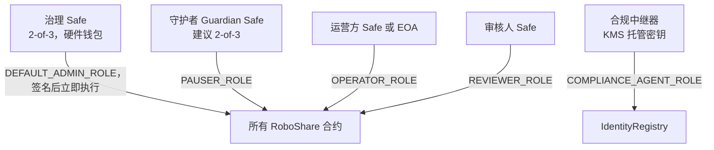

# RoboShare — 安全模型

状态：**草案（DRAFT，Phase 1）。** 设计层面的控制措施。目前尚无任何一项已实现或经过测试。上主网前必须进行独立的外部审计；内部测试和本文件均不能替代外部审计。

## 1. 权限结构

- 部署 EOA 在同一脚本中授予各角色、将 `DEFAULT_ADMIN_ROLE` 直接交给治理 Safe，并放弃自身所有权限。部署后检查会断言没有任何 EOA 保留管理权限。
- 没有时间锁（D-16，2026-10-11 Charlene 决定）：治理操作在 2 名签名人签名并执行后立即生效，用户和守护者都没有提前预警或取消的窗口。因此签名人密钥必须使用硬件钱包、分开保管，并对每笔 Safe 交易实时告警。
- 治理、守护者、运营方和审核人的签名者集合不得存在文档记录以外的重叠。

## 2. 最小权限矩阵

参见 [SMART_CONTRACT_SPEC.md §2](SMART_CONTRACT_SPEC.md)。关键属性：

- 任何角色都不能提取托管资金，除非是通过 `settle` 转入已配置的金库，或通过退款返还给认购人。
- 任何角色都不能提取分配资金，除非是转给持有人（领取）、费用接收方（按计算所得费用）或金库（尾差（dust），且仅在 `CLOSED` 之后）。
- 任何角色都不能编辑或删除审计记录；修订以追加方式进行。
- 任何角色都不能提高供应上限。
- 报告、批次和项目核验适用双人规则，通过 `msg.sender != submitter/proposer/registrant` 强制执行。由于同一人控制的两个密钥会使该规则失效，运营方和审核人角色应为签名者互不重叠的 Safe。

## 3. 合约层控制

| 控制措施 | 适用范围 |
|---|---|
| 基于角色的访问控制（`AccessControl`） | 全部 |
| 可暂停（由守护者暂停，由治理解除暂停） | 代币、募集、分配合约、身份写入 |
| ReentrancyGuard + 检查-生效-交互（checks-effects-interactions）模式 | 募集、分配合约 |
| SafeERC20 + 拉取资金时的余额差额校验 | 募集、分配合约 |
| 仅使用整数运算（Solidity ≥0.8 的溢出检查算术，乘积可能溢出处使用 `Math.mulDiv`） | 分配合约 |
| 输入校验（非零 id、已排序且唯一的持有人、有界数组、时间窗口） | 全部 |
| 重放/重复保护（recordId 唯一性、期间上限、仅允许一个待处理批次、已领取标记） | 审计登记合约、分配合约 |
| 供应上限 + 不可变的铸造者 | 代币 |
| 在 `_update` 中实施限制转让（只检查冻结名单；不做 KYC，没有资格检查） | 代币 |
| 显式状态机 | 资产登记合约 |
| 每次状态变更均发出事件 | 全部 |
| 不可升级（无代理合约） | 全部 |
| 链 ID + 地址校验 | AaveReader |

## 4. 链下控制

- **机密信息**：绝不进入 git；`.env.example` 仅包含变量名；CI 通过 OIDC 访问云端机密存储；CI 中运行 gitleaks。
- **密钥**：治理/守护者/审核人密钥为 Safe 中的硬件钱包。唯一的服务器签名者（合规中继器）使用 KMS 支持的签名器，仅拥有 `COMPLIANCE_AGENT_ROLE`，并受限流约束。
- **API**：SIWE 绑定 domain + 链；httpOnly SameSite=strict Cookie；修改操作使用 CSRF 令牌；严格的 CSP；使用 zod 进行输入校验；按层级区分 DTO；限流；每次管理端修改操作均记入审计日志。
- **数据**：独立的 `compliance` schema 和数据库角色；敏感列使用 pgcrypto/KMS 信封加密；私有存储桶启用 SSE-KMS、版本控制，并对已锚定文件启用对象锁定；预签名 URL ≤ 5 分钟；访问日志。
- **供应链**：固定版本、提交 lockfile、`forge install` 固定到标签、Dependabot/Renovate 并经审查、`pnpm audit` + OSV-Scanner、CI 中运行 Slither（可选 Aderyn）。
- **模拟组件**：TEST-ONLY 模拟位于 `test/` 或 `apps/*/src/dev/` 下，不包含在生产构建中，并在 `CHAIN_ID == 56` 时拒绝运行。

## 5. 升级与迁移策略

合约不可升级。若发现漏洞：
1. 守护者暂停受影响的合约。
2. 治理进行评估；若资金面临风险，适用 [INCIDENT_RESPONSE.md](INCIDENT_RESPONSE.md) 中的处置手册。
3. 修复后的合约用于**新**项目部署。现有项目在安全的前提下继续使用其原合约；否则进行迁移（快照 + 按 1:1 向相同的合格持有人铸造新代币，旧代币永久暂停），迁移需经治理批准、通知投资者，且必须为权益文件 (Rights Document) 所允许。

## 6. 监控

对以下情况发出告警：任何 `RoleGranted/RoleRevoked`、治理 Safe 上的 `ExecutionSuccess`/`ApproveHash`、`Paused`、`WalletFrozen`、超过阈值的批次提案、对账不一致、索引器延迟 > N 个区块、中继交易失败、冻结/解冻操作量异常。

## 7. 上主网前必须完成的审查

- 完整的 Foundry 测试套件全部通过并附覆盖率报告；以高深度运行不变量测试。
- Slither 发现项已分级处理并记录。
- 独立的智能合约审计，所有高/中危发现项均已修复或以书面形式接受。
- 对权益文件 (Rights Document)、募集条款、风险披露和 UI 文案进行法律审查。
- **不做 KYC/AML**：项目负责人 2026-10-11 决定（“都不要KYC验证了”“kyc 验证这个功能都去掉”，见 PHASE1_ANALYSIS D-24）完全移除 KYC/投资资格功能，`IdentityRegistry` 只保留冻结名单，用于拦截被盗或受制裁的钱包。主网前必须由律师评估不做 KYC/AML 的合规风险（证券发行、反洗钱、制裁）。
- 在测试网上对完整生命周期进行彩排，包括一次暂停和一次被驳回的批次。
- 明确的书面主网部署批准。

### `pnpm audit` 忽略清单（`package.json` → `pnpm.auditConfig.ignoreGhsas`）

| GHSA | 包 | 忽略理由 | 复查条件 |
|---|---|---|---|
| GHSA-mrhx-c7xc-m3w5 | zod（仅 `@reown/appkit-wallet` 自带的 3.22.4） | 我们自己的代码和 viem/abitype 已全部升到 zod 4.6.7。剩下这份是 WalletConnect/Reown 钱包库写死的旧版，上游最新版也仍是 3.22.4，且它的 schema 用了 zod 4 不兼容的单参数 `z.record()`，不能强制覆盖。漏洞需要“带长度约束的集合”才会触发，而 appkit-wallet 的 schema 里没有任何 `.min/.max/.length` 约束，只用来解析 Reown 自家 iframe 的消息，不经过用户输入。 | 2026-10-27 审核。`@reown/appkit-wallet` 升级到 zod ≥4.6.6 时删掉此条。 |
