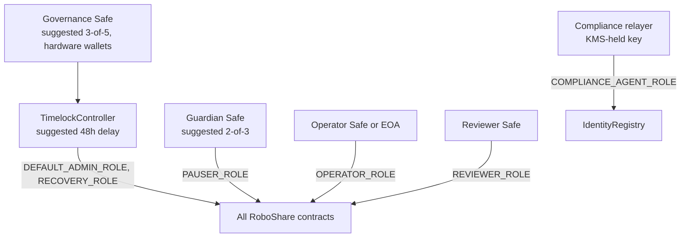

# RoboShare — Security Model

Status: **DRAFT (Phase 1).** Design-level controls. None have been implemented or tested yet. An independent external audit is required before mainnet; internal tests and this document do not substitute for it.

## 1. Authority structure

- Deployment EOA grants roles, transfers `DEFAULT_ADMIN_ROLE` to the timelock, and renounces everything in the same script. A post-deploy check asserts no EOA retains admin.
- The timelock's canceller role is held by the guardian Safe so a malicious scheduled operation can be cancelled during the delay.
- Signer sets for governance, guardian, operator and reviewer must not overlap beyond what is documented.

## 2. Least privilege matrix

See [SMART_CONTRACT_SPEC.md §2](SMART_CONTRACT_SPEC.md#2-roles-and-authority). Key properties:

- No role can withdraw escrow except to the configured treasury via `settle`, or to subscribers via refunds.
- No role can withdraw distribution funds except to holders (claims), the fee recipient (computed fee), or the treasury (dust, only after `CLOSED`).
- No role can edit or delete an audit record; amendments append.
- No role can raise the supply cap.
- Two-person rule for reports, batches, and project verification, enforced with `msg.sender != submitter/proposer/registrant`. Because two keys controlled by one person would defeat this, operator and reviewer roles should be Safes with disjoint signers.

## 3. Contract-level controls

| Control | Where |
|---|---|
| Role-based access (`AccessControl`) | all |
| Pausable (pause by guardian, unpause by governance) | token, offering, distributor, identity writes |
| ReentrancyGuard + checks-effects-interactions | offering, distributor |
| SafeERC20 + balance-delta verification on pulls | offering, distributor |
| Integer math only (Solidity ≥0.8 checked arithmetic, `Math.mulDiv` where products could overflow) | distributor |
| Input validation (non-zero ids, sorted unique holders, bounded arrays, time windows) | all |
| Replay / duplicate protection (recordId uniqueness, period cap, one pending batch, claimed flags) | audit registry, distributor |
| Supply cap + immutable minter | token |
| Restricted transfers in `_update` | token |
| Explicit state machine | asset registry |
| Events for every state change | all |
| No upgradeability (no proxies) | all |
| Chain ID + address verification | AaveReader |

## 4. Off-chain controls

- **Secrets**: never in git; `.env.example` holds names only; CI uses OIDC to cloud secret store; gitleaks in CI.
- **Keys**: governance/guardian/reviewer keys are hardware wallets inside Safes. The only server signer (compliance relayer) uses a KMS-backed signer, has only `COMPLIANCE_AGENT_ROLE`, and is rate-limited.
- **API**: SIWE with domain + chain binding; httpOnly SameSite=strict cookies; CSRF tokens on mutations; strict CSP; input validation with zod; per-tier DTOs; rate limiting; audit log for every admin mutation.
- **Data**: separate `compliance` schema and DB role; pgcrypto/KMS envelope encryption for sensitive columns; private bucket with SSE-KMS, versioning, object lock for anchored files; pre-signed URLs ≤ 5 minutes; access logs.
- **Supply chain**: pinned versions, lockfiles committed, `forge install` pinned to tags, Dependabot/Renovate with review, `pnpm audit` + OSV-Scanner, Slither (and optionally Aderyn) in CI.
- **Mocks**: TEST-ONLY mocks live under `test/` or `apps/*/src/dev/`, are excluded from production builds, and refuse to run when `CHAIN_ID == 56`.

## 5. Upgrade and migration policy

Contracts are non-upgradeable. If a vulnerability is found:
1. Guardian pauses affected contracts.
2. Governance assesses; for funds at risk, the runbook in [INCIDENT_RESPONSE.md](INCIDENT_RESPONSE.md) applies.
3. Fixed contracts deploy for **new** projects. Existing projects continue on their contracts if safe; otherwise a migration (snapshot + new token minted 1:1 to the same eligible holders, old token permanently paused) requires governance approval, investor notice, and must be permitted by the Rights Document.

## 6. Monitoring

Alert on: any `RoleGranted/RoleRevoked`, `CallScheduled` on the timelock, `Paused`, `ForcedTransfer`, `WalletFrozen`, batch proposals above a threshold, reconciliation mismatches, indexer lag > N blocks, failed relayer txs, unusual eligibility-update volume.

## 7. Required reviews before mainnet

- Full Foundry suite green with coverage report; invariant runs at high depth.
- Slither findings triaged and documented.
- Independent smart contract audit with all high/medium findings resolved or accepted in writing.
- Legal review of Rights Document, offering terms, risk disclosures, and UI copy.
- Testnet dress rehearsal of the full lifecycle including a pause and a rejected batch.
- Explicit written mainnet deployment approval.
