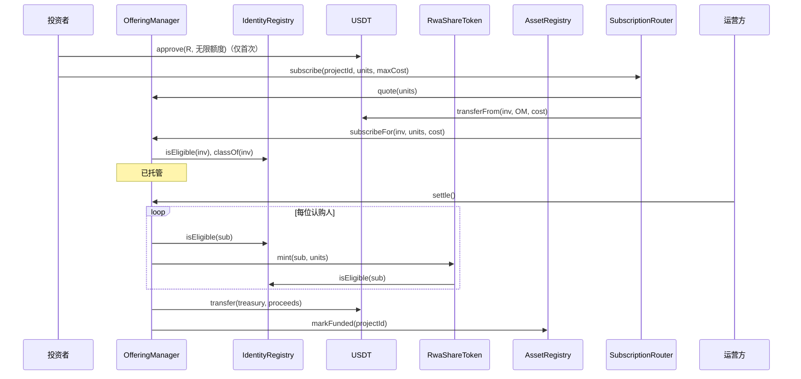
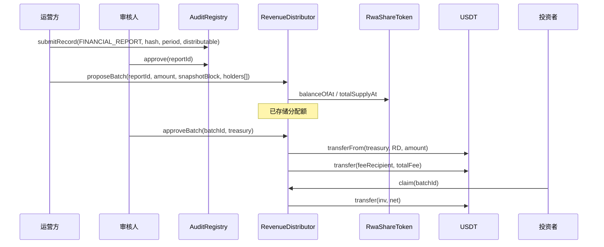

# RoboShare — 智能合约规范

状态：**草案（DRAFT，第 1 阶段）。** 仅为规范。尚未编写、编译或测试任何 Solidity 代码。函数签名可能在第 2 阶段发生变化；任何变更都将在本文档中同步体现。

目标链：BNB Smart Chain（BSC）（测试网 chain ID 97，主网 chain ID 56）。Solidity 0.8.x（确切版本固定在 `foundry.toml` 中）。OpenZeppelin Contracts v5.x（固定确切标签）。所有合约均**不可升级**（决策 D-15）。

> EVM 目标说明：`evm_version` 设置必须与部署时 BSC 支持的操作码相匹配。第 2 阶段将显式设置该值，并在依赖较新的操作码（例如 `PUSH0`、瞬态存储）之前，先部署到 chain 97 进行验证。

---

## 1. 模块概览

| 模块 | 数量 | 职责 |
|---|---|---|
| `AssetRegistry` | 1（单例） | 项目与资产身份、发行方引用、生命周期状态机、指向各项目合约的链接 |
| `AuditRegistry` | 1 | 仅追加的文档与报告哈希、审核状态、修订 |
| `IdentityRegistry` | 1 | 钱包投资资格（状态、类别、司法管辖区、到期时间）、冻结 |
| `ProjectFactory` | 1 | 部署并连接每个项目的三件套合约；在 `AssetRegistry` 中建立关联 |
| `RwaShareToken` | 每个项目 1 个 | 限制转让的 ERC-20，decimals 为 0，上限 100，余额检查点 |
| `SubscriptionRouter` | 1（单例） | 统一认购入口：用户只需对它授权一次 USDT，之后在任何项目中直接按份额购买（D-23） |
| `OfferingManager` | 每个项目 1 个 | 托管认购、结算（铸造 + 释放资金）、退款 |
| `RevenueDistributor` | 每个项目 1 个 | 与报告绑定的批次、分档费率分配、主动领取（pull）、尾差（dust） |
| `AaveReader` | 1（第 5 阶段） | 从经过验证的 Aave V3 市场进行只读读取 |
| `ICrossChainGateway` | 仅接口 | 为未来使用而记录；**未实现，也未接入**（D-18） |

为何拆分而非使用单一合约：每项职责对应不同的权限集合与失效模式。按项目划分的合约隔离了账务，使一个项目中的缺陷或冻结不会触及另一个项目的资金。

如果 `ProjectFactory` 在内嵌三份创建代码后超过 EIP-170 规定的 24 KB 代码上限，第 2 阶段将选择以下方案之一：将其拆分为按类型划分的部署器，或采用脚本化部署，随后由仅限治理调用的 `AssetRegistry.linkContracts` 在链上验证连接关系。该决策将在第 2 阶段记录。

## 2. 角色与权限

所有合约均使用 OpenZeppelin `AccessControl`。`DEFAULT_ADMIN_ROLE` 直接由**治理 Safe**（2-of-3）持有，没有时间锁，签名后立即执行（D-16，2026-10-11 修订）。部署完成后，没有任何 EOA 持有 `DEFAULT_ADMIN_ROLE`。

| 角色 | 持有者（目标） | 可以 | 不可以 |
|---|---|---|---|
| `DEFAULT_ADMIN_ROLE` | 治理 Safe（2-of-3） | 授予/撤销角色、解除暂停、在开放前配置募集、取消募集、执行标记为 GOV 的生命周期状态转换、设置费用接收方/金库（经治理 Safe） | 直接铸造、将托管或分配资金转给自己、编辑记录 |
| `OPERATOR_ROLE` | 运营方 Safe 或运维 EOA | 注册项目、提交文档/报告、提议批次、`claimFor` | 批准自己提交的内容、铸造、变更角色 |
| `REVIEWER_ROLE` | 财务/审核 Safe | 验证项目、批准/驳回报告与批次 | 批准任何由其自身提交的内容（通过 `msg.sender != submitter` 强制执行） |
| `COMPLIANCE_AGENT_ROLE` | 合规中继器（热密钥，链下限速） | 设置/续期/撤销投资资格、冻结/解冻 | `IdentityRegistry` 之外的任何操作 |
| `PAUSER_ROLE` | 守护者（Guardian）Safe | 对代币、募集、认购入口、分配合约、身份写入执行 `pause()`；`suspend` 项目 | 解除暂停、转账、变更配置 |
| `MINTER`（不是角色，而是不可变绑定） | 该项目的 `OfferingManager` | 在上限内铸造 | — |
| `FACTORY_ROLE` | `ProjectFactory` | 一次性关联各项目合约 | 重新关联、变更状态 |

在代码中强制执行的职责分离规则：
- 报告：`approver != submitter`。
- 批次：`approver != proposer`。
- 项目验证：`verifier != registrant`。

## 3. AssetRegistry

### 3.1 存储

```solidity
enum ProjectState { NONE, DRAFT, VERIFIED, OFFERING, FUNDED, ACTIVE, SUSPENDED,
                    EXIT_PENDING, TERMINATED, CLOSED, CANCELLED }

struct Project {
    bytes32 assetId;        // keccak256(abi.encode(VIN, salt)); VIN + salt kept off-chain
    bytes32 issuerId;       // opaque issuing-entity identifier
    bytes32 rightsDocHash;  // hash of the Rights Document defining what a unit represents
    ProjectState state;
    address registrant;
    address token;
    address offering;
    address distributor;
    uint64  createdAt;
    uint64  fundedAtBlock;  // set on FUNDED; lower bound for distribution snapshots
}
mapping(bytes32 projectId => Project) projects;
mapping(bytes32 assetId => bytes32 projectId) assetToProject; // never cleared
```

### 3.2 函数

| 函数 | 访问权限 | 说明 |
|---|---|---|
| `registerProject(projectId, assetId, issuerId, rightsDocHash)` | OPERATOR | 回滚错误：`ProjectExists`、`AssetAlreadyRegistered`、`ZeroValue` |
| `updateDraft(projectId, issuerId, rightsDocHash)` | OPERATOR | 仅在 `DRAFT` 状态下 |
| `transition(projectId, newState, reasonHash)` | 见下表 | `reasonHash` 必须非零，且应存在于 AuditRegistry 中 |
| `linkContracts(projectId, token, offering, distributor)` | FACTORY_ROLE | 仅一次，且仅在 `VERIFIED` 状态下 |
| `markFunded(projectId)` / `markOffering` / `markCancelled` | 仅限该项目的 `OfferingManager` | 由募集结果驱动 |
| `getProject(projectId)` / `stateOf(projectId)` | 只读 | |

### 3.3 状态转换表

| 从 | 到 | 调用方 |
|---|---|---|
| DRAFT | VERIFIED | REVIEWER（≠ 注册人） |
| DRAFT | CANCELLED | OPERATOR 或 GOV |
| VERIFIED | DRAFT | REVIEWER |
| VERIFIED | OFFERING | 已关联的 OfferingManager（`open`，由 GOV 触发） |
| VERIFIED | CANCELLED | GOV |
| OFFERING | FUNDED | 已关联的 OfferingManager（`settle`） |
| OFFERING | CANCELLED | 已关联的 OfferingManager（`cancel` / `finalizeFailed`） |
| FUNDED | ACTIVE | GOV |
| FUNDED, ACTIVE, SUSPENDED | TERMINATED | GOV |
| ACTIVE | SUSPENDED | GOV 或 PAUSER |
| SUSPENDED | ACTIVE | GOV |
| ACTIVE, SUSPENDED | EXIT_PENDING | GOV |
| EXIT_PENDING, TERMINATED | CLOSED | GOV，且仅当分配合约报告不存在 `PROPOSED` 批次时 |

任何其他状态组合都会以 `InvalidTransition(from, to)` 回滚。`CANCELLED` 和 `CLOSED` 为终态。

状态是**调用方作出的声明/证明（attestation）**。`ACTIVE` 表示治理方已声明该车辆处于运营中，并以 `reasonHash` 引用相应证据；链本身不会、也无法对此进行验证。

### 3.4 事件

`ProjectRegistered(projectId, assetId, issuerId, rightsDocHash, registrant)`、`ProjectStateChanged(projectId, from, to, reasonHash, actor)`、`ProjectContractsLinked(projectId, token, offering, distributor)`、`DraftUpdated(projectId, issuerId, rightsDocHash)`。

## 4. AuditRegistry

仅追加。任何内容都不会被覆盖；修订是指向其所取代记录的新记录。

```solidity
enum RecordKind { DOCUMENT, FINANCIAL_REPORT, EVIDENCE, ATTESTATION }
enum RecordStatus { NONE, SUBMITTED, APPROVED, REJECTED, SUPERSEDED }

struct Record {
    bytes32 projectId;
    RecordKind kind;
    RecordStatus status;
    bytes32 contentHash;     // sha-256 or keccak-256 of canonical bytes (algorithm id in docType)
    bytes32 docType;         // e.g. "INSURANCE_POLICY", "PURCHASE_AGREEMENT", "PNL_REPORT"
    bytes32 offchainRef;     // opaque storage key; never a public URL to a private file
    uint32  version;
    bytes32 supersedes;      // recordId or 0
    uint64  periodStart;     // reports only
    uint64  periodEnd;       // reports only
    uint256 distributableAmount; // reports only, in payment-token base units
    address paymentToken;    // reports only
    address submitter;
    address reviewer;
    uint64  submittedAt;
    uint64  reviewedAt;
}
// recordId = keccak256(abi.encode(projectId, kind, contentHash))
mapping(bytes32 => Record) records;
mapping(bytes32 projectId => mapping(bytes32 periodKey => bytes32 recordId)) activeReportForPeriod;
```

| 函数 | 访问权限 | 规则 |
|---|---|---|
| `submitRecord(...)` | OPERATOR | 重复的 `recordId` 会回滚；报告要求 `periodEnd > periodStart` 且代币地址非零；`distributableAmount` 可以为 0（亏损期间，无法创建批次） |
| `approve(recordId)` | REVIEWER ≠ 提交人 | `SUBMITTED → APPROVED`；对于报告，设置 `activeReportForPeriod`，若其并非取代当前有效报告则以 `PeriodAlreadyApproved` 失败 |
| `reject(recordId, reasonHash)` | REVIEWER ≠ 提交人 | `SUBMITTED → REJECTED` |
| `submitAmendment(prevRecordId, ...)` | OPERATOR | 新记录，`supersedes = prev`；批准后，原记录变为 `SUPERSEDED` |
| `verify(recordId, contentHash) → bool` | 只读 | 供前端"验证文档"按钮使用 |

事件：`RecordSubmitted`、`RecordApproved`、`RecordRejected`、`RecordSuperseded`。

哈希匹配证明该文件与锚定时的内容逐字节相同。它**不能**证明文档是真实的或内容属实。

## 5. IdentityRegistry

```solidity
enum EligibilityStatus { NONE, ELIGIBLE, FROZEN }
struct Eligibility {
    EligibilityStatus status;
    uint16  investorClass;     // e.g. 1 = accredited (US), 2 = professional (EU) — codebook off-chain
    uint16  jurisdiction;      // ISO-3166 numeric
    uint64  expiresAt;
    bytes32 attestationRef;    // hash of provider attestation id; no PII
}
mapping(address => Eligibility) eligibility;
```

| 函数 | 访问权限 |
|---|---|
| `setEligibility(wallet, class, jurisdiction, expiresAt, attestationRef)` | COMPLIANCE_AGENT |
| `batchSetEligibility(...)` | COMPLIANCE_AGENT，每次调用最多 50 个 |
| `revoke(wallet, reasonCode)` → 状态 `NONE` | COMPLIANCE_AGENT |
| `freeze(wallet, reasonCode)` / `unfreeze(wallet)` | COMPLIANCE_AGENT（冻结）、GOV（解冻） |
| `isEligible(wallet) → bool` | 只读：`status == ELIGIBLE && block.timestamp < expiresAt` |
| `isFrozen(wallet) → bool` | 只读 |
| `classOf(wallet)`、`jurisdictionOf(wallet)` | 只读 |

事件：`EligibilitySet(wallet, class, jurisdiction, expiresAt, attestationRef, agent)`、`EligibilityRevoked`、`WalletFrozen`、`WalletUnfrozen`。

`MockComplianceProvider` **仅**存在于 `test/mocks/` 下及开发环境后端中。它被标注为 TEST-ONLY（仅限测试），且当 `CHAIN_ID == 56` 时后端会拒绝启动它。

## 6. RwaShareToken

OpenZeppelin `ERC20` + `AccessControl` + `Pausable`，并使用 OpenZeppelin `Checkpoints` 记录历史余额。

### 6.1 不可变参数

`projectId`、`assetRegistry`、`identityRegistry`、`CAP = 100`、`decimals() = 0`、`allowedClassesMask`（本项目允许的投资者类别位掩码）。

### 6.2 行为

- `bindMinter(offering)`：FACTORY_ROLE，仅一次。
- `mint(to, units)`：仅限已绑定的铸造方；`totalSupply + units <= CAP`；`to` 必须具备投资资格且类别被允许。
- MVP 中不提供 `burn`。
- 重写 `_update(from, to, value)`，适用于 `transfer`、`transferFrom` 和铸造：
  - `whenNotPaused`。
  - 对于普通转让：项目状态 ∈ {FUNDED, ACTIVE}（D-12）；`!isFrozen(from)`；`isEligible(to)`；`!isFrozen(to)`；`to` 的类别被允许；`value > 0`。
  - 写入以 `block.number` 为键的余额与总供应量检查点。
- `balanceOfAt(account, blockNumber)`、`totalSupplyAt(blockNumber)`，适用于 `blockNumber < block.number`。
- `canTransfer(from, to, value) → (bool, bytes32 reasonCode)` 只读函数，使钱包和 UI 能在发送前解释失败原因。
- 标准的 `Transfer` 和 `Approval` 事件。`approve` 不受限制（标准 ERC-20）；限制在价值转移时生效。

ERC-20 一致性：接口与事件均为标准形式。当限制条件生效时转让会回滚；这为 ERC-20 所允许，但意味着该代币无法与假定可自由转让的协议（DEX、大多数借贷市场、大多数跨链桥）配合使用。这一点已在 TOKENOMICS 和 RISK_DISCLOSURES 中披露。

### 6.3 不提供找回功能（D-14）

代币没有 `forcedTransfer`，也没有 `RECOVERY_ROLE`。任何角色（包括治理）都无法在持有人不签名的情况下移动其代币。投资人丢失私钥将永久失去对应单位及其分配。

### 6.4 暂停

`pause()`：PAUSER。`unpause()`：DEFAULT_ADMIN。事件来自 OZ `Pausable`。

## 7. OfferingManager

### 7.1 配置（在 `open` 之前设置，之后不可变）

```solidity
struct OfferingConfig {
    IERC20  paymentToken;   // must equal SubscriptionRouter.USDT (USDT BEP20, D-22); decimals read on-chain
    uint256 unitPrice;      // payment-token base units per unit
    uint32  maxUnits;       // must equal token CAP (100)
    uint32  minUnits;       // 1..maxUnits, set per offering by governance (partial fill allowed, D-4)
    uint32  perWalletMax;   // 1..100
    uint64  startTime;
    uint64  endTime;
    address treasury;       // issuer treasury Safe; receives proceeds at settlement
    bytes32 termsHash;      // AuditRegistry recordId of the offering terms
}
```

`configure(cfg)`：GOV，仅在项目处于 `VERIFIED` 且募集尚未开放时。`open()`：GOV，将项目转为 `OFFERING`。

### 7.2 认购生命周期

```solidity
enum SubStatus { NONE, ESCROWED, SETTLED, REFUNDABLE, REFUNDED }
mapping(address => uint32) unitsOf; mapping(address => uint256) paidOf; mapping(address => SubStatus) statusOf;
address[] subscribers; // ≤ 100 because each subscription is ≥ 1 unit and maxUnits = 100
uint32 unitsSold;
```

| 函数 | 访问权限 | 规则 |
|---|---|---|
| `quote(units) → cost` | 只读 | `units × unitPrice` |
| `subscribeFor(investor, units, cost)` | 仅 `SubscriptionRouter`（构造时不可变绑定） | 状态为 OFFERING，`startTime ≤ now < endTime`，`units > 0`，`unitsSold + units ≤ maxUnits`，`unitsOf + units ≤ perWalletMax`，`investor` 具备投资资格且类别被允许，未暂停，nonReentrant。`cost == quote(units)`，并核验本合约 USDT 余额比已记账托管总额正好多出 `cost`（拒绝转账收费型代币或少转）。任一检查失败则整笔交易回滚，USDT 转账一并撤销。 |
| `excludeSubscriber(wallet, reasonHash)` | GOV | 结算之前；标记为 `REFUNDABLE`，减少 `unitsSold`（针对已失去投资资格的认购人） |
| `settle()` | 任何人（2026-10-11 起，满额后可立即结算） | `unitsSold ≥ minUnits` 且（`now ≥ endTime` 或 `unitsSold == maxUnits`）；每个 `ESCROWED` 认购人必须仍具备投资资格，否则以 `SubscriberIneligible(wallet)` 回滚（需先由 GOV 排除）；为每位认购人铸造；将募集款转入 `treasury`；注册表 → FUNDED |
| `finalizeFailed()` | 任何人 | `now ≥ endTime` 且 `unitsSold < minUnits`；所有 `ESCROWED` → `REFUNDABLE`；注册表 → CANCELLED |
| `cancel(reasonHash)` | GOV | 结算之前；全部 → `REFUNDABLE`；注册表 → CANCELLED |
| `claimRefund()` | 认购人 | `REFUNDABLE → REFUNDED`，先更新状态再转账，nonReentrant，暂停期间被阻止（D-21） |

除 `settle`（转入已配置的金库）和 `claimRefund`（转给认购人）外，没有任何函数允许任何角色提取托管资金。默认不支持在募集窗口期内撤回认购；如需冷静期权利，属于法律层面的决策（见 PHASE1_ANALYSIS §8）。

事件：`OfferingConfigured`、`OfferingOpened`、`Subscribed(wallet, units, amount)`、`SubscriberExcluded`、`OfferingSettled(unitsSold, proceeds, treasury)`、`OfferingFailed`、`OfferingCancelled`、`RefundClaimed(wallet, amount)`。

### 7.3 SubscriptionRouter（统一认购入口，D-23）

目的：用户在第一次购买时对 `SubscriptionRouter` 授权一次 USDT，之后在 DApp 中只需选择项目和份额，一笔交易完成认购，无需每次重新授权。

```solidity
contract SubscriptionRouter {
    IERC20 public immutable USDT;            // USDT BEP20, verified on-chain at deployment (D-22)
    IAssetRegistry public immutable registry;
    function subscribe(bytes32 projectId, uint32 units, uint256 maxCost) external; // nonReentrant, whenNotPaused
}
```

`subscribe(projectId, units, maxCost)` 流程：
1. 从 `AssetRegistry` 读取该项目已关联的 `OfferingManager`（由工厂关联，不能由调用者指定地址）；未关联则回滚。
2. `cost = offering.quote(units)`；要求 `cost ≤ maxCost`（防止选错项目或价格与界面显示不符）。
3. `USDT.safeTransferFrom(msg.sender, offering, cost)`：资金**直接**从用户钱包转入该项目的托管合约，路由合约本身从不持有资金。
4. `offering.subscribeFor(msg.sender, units, cost)`：由 OfferingManager 完成全部资格与额度检查，失败则整笔回滚。

安全约束（第 2 阶段测试必须覆盖）：
- 路由合约**只会**从 `msg.sender` 本人拉取资金，任何人（包括治理）都无法动用其他用户的授权额度。
- 资金只能流向 `AssetRegistry` 中已关联的 `OfferingManager`，且只在一次认购中拉取 `quote(units)` 的精确金额。
- 没有提款、没有管理员转账函数、不可升级；唯一的管理操作是守护者 `pause()`（治理 `unpause()`），暂停后所有认购停止。
- 由于用户授权的是这一个单例合约，它是全平台风险最集中的位置，需在外部审计中重点审查。

授权额度（DApp 行为，D-23）：首次购买时检测 `allowance(user, router)`，不足时引导用户授权。默认**无限授权**（`type(uint256).max`，已于 2026-10-09 确认）。授权前 DApp 明确提示：授权在撤销前一直有效，若在钓鱼网站授权或合约存在漏洞，钱包内全部 USDT 都有风险。之后每次购买都是一笔交易。DApp 显示当前授权状态，并提供"撤销授权"（授权为 0）按钮。因此第 2 阶段的路由合约安全约束（只从 `msg.sender` 拉取、只转入已关联项目、精确金额）是硬性要求。

USDT 不假定支持 EIP-2612 `permit`；如经核实支持，可作为后续优化。

## 8. RevenueDistributor

### 8.1 费率档位（每次部署不可变）

```solidity
// thresholds ascending, inclusive lower bounds in whole units
uint32[5] TIER_MIN = [1, 5, 10, 20, 50];
uint16[5] TIER_BPS = [2000, 1750, 1500, 1250, 1000];
```

在构造时校验：阈值从 1 开始严格递增，基点非递增，且每项 ≤ 10 000。变更档位意味着部署新的分配合约，且仅适用于新项目。

### 8.2 批次数据

```solidity
enum BatchStatus { NONE, PROPOSED, CLAIMABLE, REJECTED }
struct Batch {
    bytes32 reportId;        // AuditRegistry APPROVED FINANCIAL_REPORT for this project
    uint256 amount;          // newly funded amount
    uint256 carriedDustIn;   // dust from previous batch added to the pool
    uint256 pool;            // amount + carriedDustIn = D
    uint256 totalNet;
    uint256 totalFee;
    uint256 dustOut;         // D − Σgross, carried to next batch
    uint64  snapshotBlock;
    address proposer;
    address approver;
    BatchStatus status;
}
struct Allocation { uint128 net; uint16 feeBps; bool claimed; }
mapping(uint256 batchId => mapping(address => Allocation)) allocations;
mapping(bytes32 reportPeriodKey => uint256) distributedForPeriod;
```

### 8.3 分配额公式（D-10）

对于每位持有人 *i*，设其快照单位数为 *uᵢ*，快照总供应量为 *U*，资金池为 *D*：

```
grossᵢ = floor(D × uᵢ / U)
bpsᵢ   = tier(uᵢ)
feeᵢ   = floor(grossᵢ × bpsᵢ / 10_000)
netᵢ   = grossᵢ − feeᵢ
dust   = D − Σ grossᵢ          (0 ≤ dust < number of holders, in base units)
```

不变量：`Σnetᵢ + Σfeeᵢ + dust == D`。

计算示例（仅作说明，与需求说明一致）：D = 10 000 美元等值，U = 100，持有人持有 10 个单位 → 毛额 1 000，档位 15 %，费用 150，净额 850。

### 8.4 函数

| 函数 | 访问权限 | 规则 |
|---|---|---|
| `proposeBatch(reportId, amount, snapshotBlock, address[] holders)` | OPERATOR | 项目状态 ∈ {ACTIVE, EXIT_PENDING, TERMINATED}；不存在其他 `PROPOSED` 批次；报告为 `APPROVED`，属于同一项目，使用同一支付代币；`amount > 0`；`distributedForPeriod + amount ≤ report.distributableAmount`；`fundedAtBlock ≤ snapshotBlock < block.number`；`holders` 严格递增（以证明唯一性），且不含零地址；`Σ balanceOfAt(hᵢ) == totalSupplyAt(snapshotBlock)` 且每个 `balanceOfAt(hᵢ) > 0`。计算并存储分配额。 |
| `approveBatch(batchId, funder)` | REVIEWER ≠ 提议人 | `PROPOSED → CLAIMABLE`；从 `funder` 精确拉取 `amount`（校验余额变化）；将 `totalFee` 转给 `feeRecipient`；记录 `distributedForPeriod`；结转 `dustOut` |
| `rejectBatch(batchId, reasonHash)` | REVIEWER | `PROPOSED → REJECTED`；不转移任何资金 |
| `claim(batchId)` / `claimMany(batchIds)` | 持有人 | 批次为 `CLAIMABLE`，`!claimed`，`net > 0`，`!isFrozen(msg.sender)`（D-13），未暂停；先设置 `claimed` 再转账；nonReentrant |
| `claimFor(batchId, holder)` | OPERATOR | 相同检查；资金始终转给 `holder` |
| `sweepDust()` | GOV | 仅当项目为 `CLOSED` 时；将结转的尾差（dust）发送至金库 |

未领取的分配额绝不会被清扫给运营方。任何长期未领取财产的处理流程均属于法律事项，在 MVP 范围之外处理。

为何采用链上计算加主动领取（pull）模式（D-11）：持有人最多 100 位，完整的分配计算可在一笔交易内完成，因此由合约本身强制执行公式和档位表，而无需信任链下的 Merkle 根。主动领取可避免单个接收方失败而阻塞所有人，并使每次操作的 gas 保持有界。代价是每个期间需要一笔较大的提议交易。

事件：`BatchProposed(batchId, reportId, amount, snapshotBlock, pool, totalNet, totalFee, dustOut)`、`AllocationRecorded(batchId, holder, units, gross, feeBps, net)`、`BatchApproved(batchId, approver, funder)`、`BatchRejected`、`Claimed(batchId, holder, net, caller)`、`DustCarried`、`DustSwept`。

## 9. 交互时序

### 9.1 认购与结算



### 9.2 报告 → 批次 → 领取



## 10. AaveReader（第 5 阶段，只读）

- 构造函数接收 `expectedChainId` 和 Aave V3 `PoolAddressesProvider`。若 `block.chainid != expectedChainId` 则回滚。
- `pool()`、`oracle()`、`dataProvider()` 通过 provider 解析，并与配置值比对；不匹配 → `MarketConfigMismatch`、`OfferingNotLinked`、`CostAboveMax`、`OnlyRouter`。
- `reserveList()`、`reserveConfig(asset)`、`reserveRates(asset)` 仅适用于显式白名单中的资产。
- 不存在 `approve`、`supply`、`borrow` 或 `withdraw` 函数。任何交易型适配器都将是一个独立的未来合约，需经过明确审查。
- 大多数读取路径将在链下 worker 中（viem `readContract`）针对同一组经过验证的地址执行；链上读取合约的存在是为了让其他合约无需为获取 Aave 数据而信任后端。是否确实需要链上读取合约由第 5 阶段决定。
- 本规范不包含任何地址。地址将取自 Aave 官方地址簿/治理记录，并在写入 `infra/deployments/<chainId>.json` 之前在链上进行交叉核对。

## 11. 跨链（未来，D-18）

`ICrossChainGateway`（仅作文档）将需要：唯一消息 ID、源链/目标链 ID、白名单源合约、重放保护、最终性阈值、速率限制、带供应量对账的销毁-铸造或锁定-铸造机制、暂停，以及失败消息恢复。`RwaShareToken` 不具备跨链桥铸造路径；如需添加，需要部署新的代币并进行单独审计。

## 12. 不变量（将使用 Foundry 不变量测试进行测试）

1. `token.totalSupply() ≤ 100` 始终成立；只有已绑定的铸造方能增加该值。
2. 每个非零余额都属于在收到单位时具备投资资格的地址。
3. `OfferingManager` USDT 余额 == 处于 `ESCROWED` 或 `REFUNDABLE` 状态的认购人已付款项之和。
4. 结算后，`token.totalSupply() == Σ units of SETTLED subscribers`（即 SETTLED 认购人的单位数之和）。
5. 对每个批次：`Σnet + Σfee + dustOut == pool`；`Σ 已领取净额 ≤ Σ net`。
6. 分配合约稳定币余额 == CLAIMABLE 批次中未领取净额之和 + 结转的尾差（dust）。
7. 任何分配额都不会被领取两次。
8. `distributedForPeriod[p] ≤ approvedReport(p).distributableAmount`。
9. 项目状态只能按照状态转换表变化。
10. 部署脚本执行完成后，除治理 Safe 外没有任何地址持有 `DEFAULT_ADMIN_ROLE`。
11. `SubscriptionRouter` 的 USDT 余额始终为 0；它只从 `msg.sender` 拉取资金，且只转入已关联的 `OfferingManager`。

## 13. 自定义错误（示意）

`ProjectExists`、`AssetAlreadyRegistered`、`InvalidTransition(from,to)`、`NotEligible(wallet)`、`WalletFrozen(wallet)`、`ClassNotAllowed`、`CapExceeded`、`TransfersDisabledInState(state)`、`OfferingNotOpen`、`OfferingWindowClosed`、`PerWalletLimit`、`UnexpectedTransferAmount`、`SubscriberIneligible`、`ReportNotApproved`、`AmountExceedsReport`、`BatchPending`、`HoldersNotSorted`、`HolderSetIncomplete`、`SnapshotOutOfRange`、`AlreadyClaimed`、`NothingToClaim`、`SelfApproval`、`MarketConfigMismatch`、`OfferingNotLinked`、`CostAboveMax`、`OnlyRouter`。
