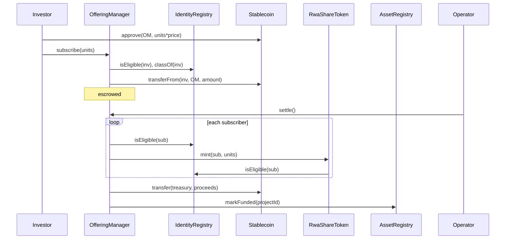
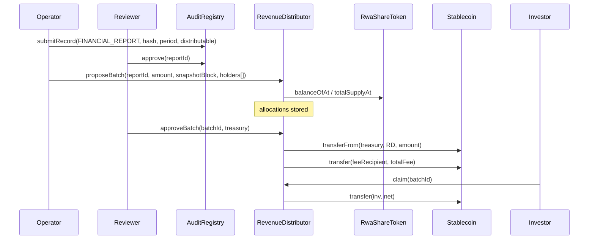

# RoboShare — Smart Contract Specification

Status: **DRAFT (Phase 1).** Specification only. No Solidity has been written, compiled, or tested. Function signatures may change during Phase 2; any change will be reflected here.

Target: BNB Smart Chain (testnet chain ID 97, mainnet chain ID 56). Solidity 0.8.x (exact version pinned in `foundry.toml`). OpenZeppelin Contracts v5.x (exact tag pinned). All contracts **non-upgradeable** (decision D-15).

> EVM target note: the `evm_version` setting must match opcodes supported by BSC at deployment time. Phase 2 will set it explicitly and verify by deploying to chain 97 before relying on newer opcodes (e.g. `PUSH0`, transient storage).

---

## 1. Module overview

| Module | Cardinality | Responsibility |
|---|---|---|
| `AssetRegistry` | 1 (singleton) | Project + asset identity, issuer reference, lifecycle state machine, links to per-project contracts |
| `AuditRegistry` | 1 | Append-only document and report hashes, review status, amendments |
| `IdentityRegistry` | 1 | Wallet eligibility (status, class, jurisdiction, expiry), freeze |
| `ProjectFactory` | 1 | Deploys and wires the per-project trio; links them in `AssetRegistry` |
| `RwaShareToken` | 1 per project | Restricted ERC-20, decimals 0, cap 100, balance checkpoints |
| `OfferingManager` | 1 per project | Escrowed subscriptions, settlement (mint + release funds), refunds |
| `RevenueDistributor` | 1 per project | Report-bound batches, tiered fee allocation, pull claims, dust |
| `AaveReader` | 1 (Phase 5) | View-only reads from a verified Aave V3 market |
| `ICrossChainGateway` | interface only | Documented for future use; **not implemented or wired** (D-18) |

Why a split rather than one contract: each responsibility has a different authority set and failure mode. Per-project contracts isolate accounting so a bug or freeze in one project cannot touch another project's funds.

If `ProjectFactory` exceeds the EIP-170 24 KB code limit when it embeds three creation codes, Phase 2 will either split it into per-type deployers or use scripted deployment followed by a governance-only `AssetRegistry.linkContracts` call that verifies wiring on-chain. The decision is recorded in Phase 2.

## 2. Roles and authority

All contracts use OpenZeppelin `AccessControl`. `DEFAULT_ADMIN_ROLE` is held by an OpenZeppelin `TimelockController` whose proposer/executor is the **governance Safe** (D-16). No EOA holds `DEFAULT_ADMIN_ROLE` after deployment.

| Role | Holder (target) | Can | Cannot |
|---|---|---|---|
| `DEFAULT_ADMIN_ROLE` | Timelock ← Governance Safe | grant/revoke roles, unpause, configure offerings before open, cancel offerings, lifecycle transitions marked GOV, set fee recipient/treasury (timelocked) | mint directly, move escrow or distribution funds to itself, edit records |
| `OPERATOR_ROLE` | Operator Safe or ops EOA | register projects, submit documents/reports, propose batches, call `settle`, `claimFor` | approve own submissions, mint, change roles |
| `REVIEWER_ROLE` | Finance/review Safe | verify projects, approve/reject reports and batches | approve anything it submitted (enforced `msg.sender != submitter`) |
| `COMPLIANCE_AGENT_ROLE` | Compliance relayer (hot key, rate-limited off-chain) | set/renew/revoke eligibility, freeze/unfreeze | anything outside `IdentityRegistry` |
| `PAUSER_ROLE` | Guardian Safe | `pause()` on token, offering, distributor, identity writes; `suspend` project | unpause, transfer, change config |
| `RECOVERY_ROLE` | Timelock ← Governance Safe | `forcedTransfer` on tokens deployed with `recoveryEnabled = true` | anything on tokens with recovery disabled |
| `MINTER` (not a role, an immutable binding) | The project's `OfferingManager` | mint up to the cap | — |
| `FACTORY_ROLE` | `ProjectFactory` | link per-project contracts once | relink, change state |

Separation rules enforced in code:
- Report: `approver != submitter`.
- Batch: `approver != proposer`.
- Project verification: `verifier != registrant`.

## 3. AssetRegistry

### 3.1 Storage

```solidity
enum ProjectState { NONE, DRAFT, VERIFIED, OFFERING, FUNDED, ACTIVE, SUSPENDED,
                    EXIT_PENDING, TERMINATED, CLOSED, CANCELLED }

struct Project {
    bytes32 assetId;        // keccak256(abi.encode(VIN, salt)); VIN + salt kept off-chain
    bytes32 issuerId;       // opaque issuing-entity identifier
    bytes32 rightsDocHash;  // hash of the Rights Document defining what a unit represents
    ProjectState state;
    address registrant;
    address token;
    address offering;
    address distributor;
    uint64  createdAt;
    uint64  fundedAtBlock;  // set on FUNDED; lower bound for distribution snapshots
}
mapping(bytes32 projectId => Project) projects;
mapping(bytes32 assetId => bytes32 projectId) assetToProject; // never cleared
```

### 3.2 Functions

| Function | Access | Notes |
|---|---|---|
| `registerProject(projectId, assetId, issuerId, rightsDocHash)` | OPERATOR | reverts `ProjectExists`, `AssetAlreadyRegistered`, `ZeroValue` |
| `updateDraft(projectId, issuerId, rightsDocHash)` | OPERATOR | only in `DRAFT` |
| `transition(projectId, newState, reasonHash)` | per table below | `reasonHash` must be non-zero and should exist in AuditRegistry |
| `linkContracts(projectId, token, offering, distributor)` | FACTORY_ROLE | once, only in `VERIFIED` |
| `markFunded(projectId)` / `markOffering` / `markCancelled` | the project's `OfferingManager` only | driven by offering outcomes |
| `getProject(projectId)` / `stateOf(projectId)` | view | |

### 3.3 Transition table

| From | To | Caller |
|---|---|---|
| DRAFT | VERIFIED | REVIEWER (≠ registrant) |
| DRAFT | CANCELLED | OPERATOR or GOV |
| VERIFIED | DRAFT | REVIEWER |
| VERIFIED | OFFERING | linked OfferingManager (`open`, GOV-triggered) |
| VERIFIED | CANCELLED | GOV |
| OFFERING | FUNDED | linked OfferingManager (`settle`) |
| OFFERING | CANCELLED | linked OfferingManager (`cancel` / `finalizeFailed`) |
| FUNDED | ACTIVE | GOV |
| FUNDED, ACTIVE, SUSPENDED | TERMINATED | GOV |
| ACTIVE | SUSPENDED | GOV or PAUSER |
| SUSPENDED | ACTIVE | GOV |
| ACTIVE, SUSPENDED | EXIT_PENDING | GOV |
| EXIT_PENDING, TERMINATED | CLOSED | GOV, and only if the distributor reports no `PROPOSED` batch |

Any other pair reverts `InvalidTransition(from, to)`. `CANCELLED` and `CLOSED` are terminal.

A state is an **attestation by the caller**. `ACTIVE` means governance attested the vehicle is in service, with evidence referenced by `reasonHash`; the chain does not and cannot verify it.

### 3.4 Events

`ProjectRegistered(projectId, assetId, issuerId, rightsDocHash, registrant)`, `ProjectStateChanged(projectId, from, to, reasonHash, actor)`, `ProjectContractsLinked(projectId, token, offering, distributor)`, `DraftUpdated(projectId, issuerId, rightsDocHash)`.

## 4. AuditRegistry

Append-only. Nothing is overwritten; amendments are new records pointing at what they supersede.

```solidity
enum RecordKind { DOCUMENT, FINANCIAL_REPORT, EVIDENCE, ATTESTATION }
enum RecordStatus { NONE, SUBMITTED, APPROVED, REJECTED, SUPERSEDED }

struct Record {
    bytes32 projectId;
    RecordKind kind;
    RecordStatus status;
    bytes32 contentHash;     // sha-256 or keccak-256 of canonical bytes (algorithm id in docType)
    bytes32 docType;         // e.g. "INSURANCE_POLICY", "PURCHASE_AGREEMENT", "PNL_REPORT"
    bytes32 offchainRef;     // opaque storage key; never a public URL to a private file
    uint32  version;
    bytes32 supersedes;      // recordId or 0
    uint64  periodStart;     // reports only
    uint64  periodEnd;       // reports only
    uint256 distributableAmount; // reports only, in payment-token base units
    address paymentToken;    // reports only
    address submitter;
    address reviewer;
    uint64  submittedAt;
    uint64  reviewedAt;
}
// recordId = keccak256(abi.encode(projectId, kind, contentHash))
mapping(bytes32 => Record) records;
mapping(bytes32 projectId => mapping(bytes32 periodKey => bytes32 recordId)) activeReportForPeriod;
```

| Function | Access | Rules |
|---|---|---|
| `submitRecord(...)` | OPERATOR | duplicate `recordId` reverts; reports require `periodEnd > periodStart`, non-zero token; `distributableAmount` may be 0 (loss period, no batch possible) |
| `approve(recordId)` | REVIEWER ≠ submitter | `SUBMITTED → APPROVED`; for reports, sets `activeReportForPeriod` and fails `PeriodAlreadyApproved` unless it supersedes the active one |
| `reject(recordId, reasonHash)` | REVIEWER ≠ submitter | `SUBMITTED → REJECTED` |
| `submitAmendment(prevRecordId, ...)` | OPERATOR | new record with `supersedes = prev`; on approval prev becomes `SUPERSEDED` |
| `verify(recordId, contentHash) → bool` | view | used by the frontend "verify document" button |

Events: `RecordSubmitted`, `RecordApproved`, `RecordRejected`, `RecordSuperseded`.

A matching hash proves the file is byte-identical to what was anchored. It does **not** prove the document is authentic or truthful.

## 5. IdentityRegistry

```solidity
enum EligibilityStatus { NONE, ELIGIBLE, FROZEN }
struct Eligibility {
    EligibilityStatus status;
    uint16  investorClass;     // e.g. 1 = accredited (US), 2 = professional (EU) — codebook off-chain
    uint16  jurisdiction;      // ISO-3166 numeric
    uint64  expiresAt;
    bytes32 attestationRef;    // hash of provider attestation id; no PII
}
mapping(address => Eligibility) eligibility;
```

| Function | Access |
|---|---|
| `setEligibility(wallet, class, jurisdiction, expiresAt, attestationRef)` | COMPLIANCE_AGENT |
| `batchSetEligibility(...)` | COMPLIANCE_AGENT, max 50 per call |
| `revoke(wallet, reasonCode)` → status `NONE` | COMPLIANCE_AGENT |
| `freeze(wallet, reasonCode)` / `unfreeze(wallet)` | COMPLIANCE_AGENT (freeze), GOV (unfreeze) |
| `isEligible(wallet) → bool` | view: `status == ELIGIBLE && block.timestamp < expiresAt` |
| `isFrozen(wallet) → bool` | view |
| `classOf(wallet)`, `jurisdictionOf(wallet)` | view |

Events: `EligibilitySet(wallet, class, jurisdiction, expiresAt, attestationRef, agent)`, `EligibilityRevoked`, `WalletFrozen`, `WalletUnfrozen`.

`MockComplianceProvider` exists **only** under `test/mocks/` and in the dev backend. It is labelled TEST-ONLY and the backend refuses to start it when `CHAIN_ID == 56`.

## 6. RwaShareToken

OpenZeppelin `ERC20` + `AccessControl` + `Pausable`, with OpenZeppelin `Checkpoints` for historical balances.

### 6.1 Immutable parameters

`projectId`, `assetRegistry`, `identityRegistry`, `CAP = 100`, `decimals() = 0`, `recoveryEnabled`, `allowedClassesMask` (bitmask of investor classes permitted for this project).

### 6.2 Behaviour

- `bindMinter(offering)`: FACTORY_ROLE, once.
- `mint(to, units)`: only the bound minter; `totalSupply + units <= CAP`; `to` must be eligible and class-allowed.
- No `burn` in the MVP.
- `_update(from, to, value)` override, applied to `transfer`, `transferFrom`, mint, and forced transfer:
  - `whenNotPaused` (forced transfer bypasses pause only if governance explicitly calls it while paused, see 6.3).
  - For ordinary transfers: project state ∈ {FUNDED, ACTIVE} (D-12); `!isFrozen(from)`; `isEligible(to)`; `!isFrozen(to)`; class of `to` allowed; `value > 0`.
  - Writes balance and total-supply checkpoints keyed by `block.number`.
- `balanceOfAt(account, blockNumber)`, `totalSupplyAt(blockNumber)` for `blockNumber < block.number`.
- `canTransfer(from, to, value) → (bool, bytes32 reasonCode)` view, so wallets and the UI can explain a failure before sending.
- Standard `Transfer` and `Approval` events. `approve` is unrestricted (standard ERC-20); restrictions apply when value moves.

ERC-20 conformance: the interface and events are standard. Transfers revert when restrictions apply; that is permitted by ERC-20 but means the token will not work with protocols that assume free transferability (DEXs, most lending markets, most bridges). This is disclosed in TOKENOMICS and RISK_DISCLOSURES.

### 6.3 Recovery (D-14)

`forcedTransfer(from, to, units, evidenceHash)`: `RECOVERY_ROLE` (timelocked), only if `recoveryEnabled`. `to` must be eligible. Emits `ForcedTransfer(from, to, units, evidenceHash)` plus the standard `Transfer`. Disabled by default; enabled per project only when the Rights Document provides for it.

### 6.4 Pause

`pause()`: PAUSER. `unpause()`: DEFAULT_ADMIN. Events from OZ `Pausable`.

## 7. OfferingManager

### 7.1 Configuration (set before `open`, then immutable)

```solidity
struct OfferingConfig {
    IERC20  paymentToken;   // allowlisted stablecoin; decimals read on-chain at configure time
    uint256 unitPrice;      // payment-token base units per unit
    uint32  maxUnits;       // must equal token CAP (100)
    uint32  minUnits;       // default 100 (all-or-nothing, D-4)
    uint32  perWalletMax;   // 1..100
    uint64  startTime;
    uint64  endTime;
    address treasury;       // issuer treasury Safe; receives proceeds at settlement
    bytes32 termsHash;      // AuditRegistry recordId of the offering terms
}
```

`configure(cfg)`: GOV, only while project is `VERIFIED` and offering not opened. `open()`: GOV, moves project to `OFFERING`.

### 7.2 Subscription lifecycle

```solidity
enum SubStatus { NONE, ESCROWED, SETTLED, REFUNDABLE, REFUNDED }
mapping(address => uint32) unitsOf; mapping(address => uint256) paidOf; mapping(address => SubStatus) statusOf;
address[] subscribers; // ≤ 100 because each subscription is ≥ 1 unit and maxUnits = 100
uint32 unitsSold;
```

| Function | Access | Rules |
|---|---|---|
| `subscribe(units)` | eligible wallet | state OFFERING, `startTime ≤ now < endTime`, `units > 0`, `unitsSold + units ≤ maxUnits`, `unitsOf + units ≤ perWalletMax`, class allowed, not paused, nonReentrant. Pulls `units × unitPrice` with `SafeERC20.safeTransferFrom` and checks the received balance delta equals the expected amount (rejects fee-on-transfer tokens). |
| `excludeSubscriber(wallet, reasonHash)` | GOV | before settlement; marks `REFUNDABLE`, reduces `unitsSold` (for subscribers who became ineligible) |
| `settle()` | OPERATOR | `unitsSold ≥ minUnits` and (`now ≥ endTime` or `unitsSold == maxUnits`); every `ESCROWED` subscriber must still be eligible, else revert `SubscriberIneligible(wallet)` (GOV excludes first); mints to each; transfers proceeds to `treasury`; registry → FUNDED |
| `finalizeFailed()` | anyone | `now ≥ endTime` and `unitsSold < minUnits`; all `ESCROWED` → `REFUNDABLE`; registry → CANCELLED |
| `cancel(reasonHash)` | GOV | before settlement; all → `REFUNDABLE`; registry → CANCELLED |
| `claimRefund()` | subscriber | `REFUNDABLE → REFUNDED`, effects before transfer, nonReentrant, blocked while paused (D-21) |

No function lets any role withdraw escrow other than `settle` (to the configured treasury) and `claimRefund` (to the subscriber). Withdrawal of a subscription during the offering window is not supported by default; a cooling-off right, if required, is a legal decision (see PHASE1_ANALYSIS §8).

Events: `OfferingConfigured`, `OfferingOpened`, `Subscribed(wallet, units, amount)`, `SubscriberExcluded`, `OfferingSettled(unitsSold, proceeds, treasury)`, `OfferingFailed`, `OfferingCancelled`, `RefundClaimed(wallet, amount)`.

## 8. RevenueDistributor

### 8.1 Fee tiers (immutable per deployment)

```solidity
// thresholds ascending, inclusive lower bounds in whole units
uint32[5] TIER_MIN = [1, 5, 10, 20, 50];
uint16[5] TIER_BPS = [2000, 1750, 1500, 1250, 1000];
```

Validated at construction: thresholds strictly ascending starting at 1, bps non-increasing, each ≤ 10 000. Changing tiers means a new distributor, only for new projects.

### 8.2 Batch data

```solidity
enum BatchStatus { NONE, PROPOSED, CLAIMABLE, REJECTED }
struct Batch {
    bytes32 reportId;        // AuditRegistry APPROVED FINANCIAL_REPORT for this project
    uint256 amount;          // newly funded amount
    uint256 carriedDustIn;   // dust from previous batch added to the pool
    uint256 pool;            // amount + carriedDustIn = D
    uint256 totalNet;
    uint256 totalFee;
    uint256 dustOut;         // D − Σgross, carried to next batch
    uint64  snapshotBlock;
    address proposer;
    address approver;
    BatchStatus status;
}
struct Allocation { uint128 net; uint16 feeBps; bool claimed; }
mapping(uint256 batchId => mapping(address => Allocation)) allocations;
mapping(bytes32 reportPeriodKey => uint256) distributedForPeriod;
```

### 8.3 Allocation formula (D-10)

For each holder *i* with snapshot units *uᵢ*, snapshot supply *U*, pool *D*:

```
grossᵢ = floor(D × uᵢ / U)
bpsᵢ   = tier(uᵢ)
feeᵢ   = floor(grossᵢ × bpsᵢ / 10_000)
netᵢ   = grossᵢ − feeᵢ
dust   = D − Σ grossᵢ          (0 ≤ dust < number of holders, in base units)
```

Invariant: `Σnetᵢ + Σfeeᵢ + dust == D`.

Worked example (illustrative, matches the master prompt): D = 10 000 USD-equivalent, U = 100, holder has 10 units → gross 1 000, tier 15 %, fee 150, net 850.

### 8.4 Functions

| Function | Access | Rules |
|---|---|---|
| `proposeBatch(reportId, amount, snapshotBlock, address[] holders)` | OPERATOR | project state ∈ {ACTIVE, EXIT_PENDING, TERMINATED}; no other `PROPOSED` batch; report is `APPROVED`, same project, same payment token; `amount > 0`; `distributedForPeriod + amount ≤ report.distributableAmount`; `fundedAtBlock ≤ snapshotBlock < block.number`; `holders` strictly ascending (proves uniqueness), no zero address; `Σ balanceOfAt(hᵢ) == totalSupplyAt(snapshotBlock)` and every `balanceOfAt(hᵢ) > 0`. Computes and stores allocations. |
| `approveBatch(batchId, funder)` | REVIEWER ≠ proposer | `PROPOSED → CLAIMABLE`; pulls exactly `amount` from `funder` (balance-delta checked); transfers `totalFee` to `feeRecipient`; records `distributedForPeriod`; carries `dustOut` |
| `rejectBatch(batchId, reasonHash)` | REVIEWER | `PROPOSED → REJECTED`; no funds moved |
| `claim(batchId)` / `claimMany(batchIds)` | holder | batch `CLAIMABLE`, `!claimed`, `net > 0`, `!isFrozen(msg.sender)` (D-13), not paused; set `claimed` then transfer; nonReentrant |
| `claimFor(batchId, holder)` | OPERATOR | same checks; funds always go to `holder` |
| `sweepDust()` | GOV | only when project `CLOSED`; sends carried dust to treasury |

Unclaimed allocations are never swept to the operator. Any long-term unclaimed-property process is a legal matter handled outside the MVP.

Why on-chain computation with pull claims (D-11): with at most 100 holders the full allocation fits in one transaction, so the contract itself enforces the formula and the tier table instead of trusting an off-chain Merkle root. Pull claims avoid a single failing recipient blocking everyone and keep gas per action bounded. The cost is one larger proposal transaction per period.

Events: `BatchProposed(batchId, reportId, amount, snapshotBlock, pool, totalNet, totalFee, dustOut)`, `AllocationRecorded(batchId, holder, units, gross, feeBps, net)`, `BatchApproved(batchId, approver, funder)`, `BatchRejected`, `Claimed(batchId, holder, net, caller)`, `DustCarried`, `DustSwept`.

## 9. Interaction sequences

### 9.1 Subscribe and settle



### 9.2 Report → batch → claim



## 10. AaveReader (Phase 5, view-only)

- Constructor takes `expectedChainId` and the Aave V3 `PoolAddressesProvider`. Reverts if `block.chainid != expectedChainId`.
- `pool()`, `oracle()`, `dataProvider()` resolved through the provider and compared against configured values; mismatch → `MarketConfigMismatch`.
- `reserveList()`, `reserveConfig(asset)`, `reserveRates(asset)` only for assets in an explicit allowlist.
- No `approve`, `supply`, `borrow`, or `withdraw` functions exist. Any transactional adapter is a separate future contract requiring explicit review.
- Most read paths will run off-chain in the worker (viem `readContract`) against the same verified addresses; the on-chain reader exists so other contracts never need to trust a backend for Aave data. Phase 5 decides whether the on-chain reader is needed at all.
- Addresses are not included in this spec. They will be taken from the official Aave address book / governance records and cross-checked on chain before being written to `infra/deployments/<chainId>.json`.

## 11. Cross-chain (future, D-18)

`ICrossChainGateway` (documentation only) would require: unique message IDs, source/destination chain IDs, allowlisted source contracts, replay protection, finality thresholds, rate limits, burn-and-mint or lock-and-mint with supply reconciliation, pause, and failed-message recovery. `RwaShareToken` has no bridge mint path; adding one requires a new token deployment and separate audit.

## 12. Invariants (to be tested with Foundry invariant tests)

1. `token.totalSupply() ≤ 100` always; only the bound minter increases it.
2. Every non-zero balance belongs to an address that was eligible at the time it received units (or a forced-transfer target that was eligible).
3. `OfferingManager` stablecoin balance == Σ paid of subscribers in `ESCROWED` or `REFUNDABLE`.
4. After settlement, `token.totalSupply() == Σ units of SETTLED subscribers`.
5. For each batch: `Σnet + Σfee + dustOut == pool`; `Σ claimed net ≤ Σ net`.
6. Distributor stablecoin balance == Σ unclaimed net of CLAIMABLE batches + carried dust.
7. No allocation is claimed twice.
8. `distributedForPeriod[p] ≤ approvedReport(p).distributableAmount`.
9. Project state only moves along the transition table.
10. No address other than the timelock holds `DEFAULT_ADMIN_ROLE` after deployment script completes.

## 13. Custom errors (indicative)

`ProjectExists`, `AssetAlreadyRegistered`, `InvalidTransition(from,to)`, `NotEligible(wallet)`, `WalletFrozen(wallet)`, `ClassNotAllowed`, `CapExceeded`, `TransfersDisabledInState(state)`, `OfferingNotOpen`, `OfferingWindowClosed`, `PerWalletLimit`, `UnexpectedTransferAmount`, `SubscriberIneligible`, `ReportNotApproved`, `AmountExceedsReport`, `BatchPending`, `HoldersNotSorted`, `HolderSetIncomplete`, `SnapshotOutOfRange`, `AlreadyClaimed`, `NothingToClaim`, `SelfApproval`, `RecoveryDisabled`, `MarketConfigMismatch`.
